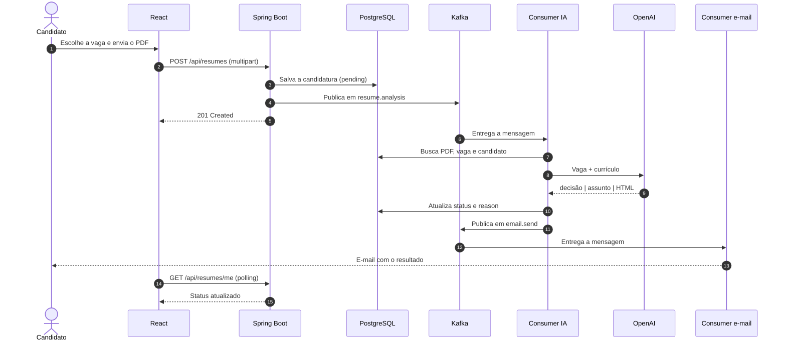
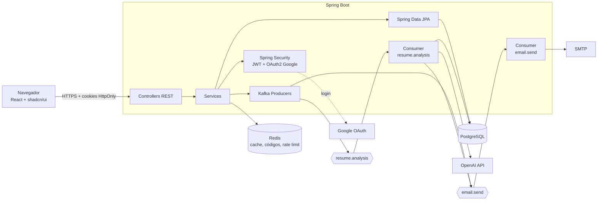
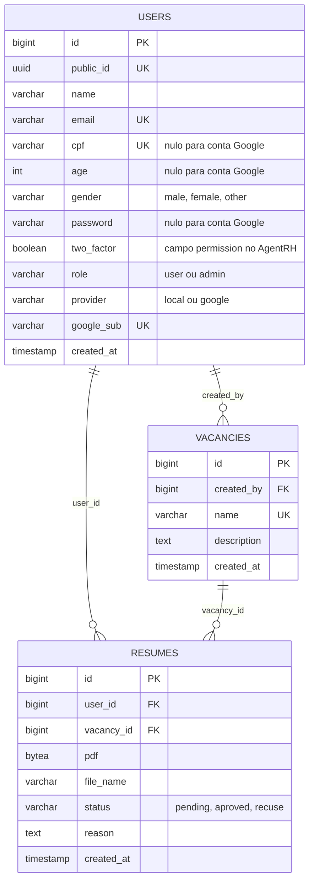
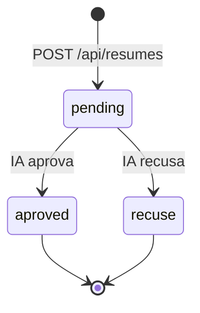
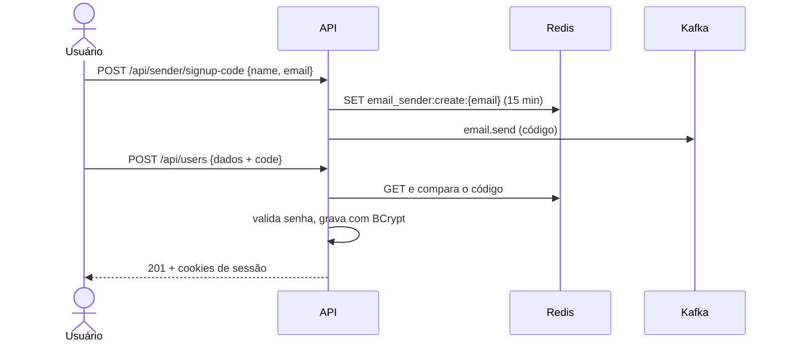
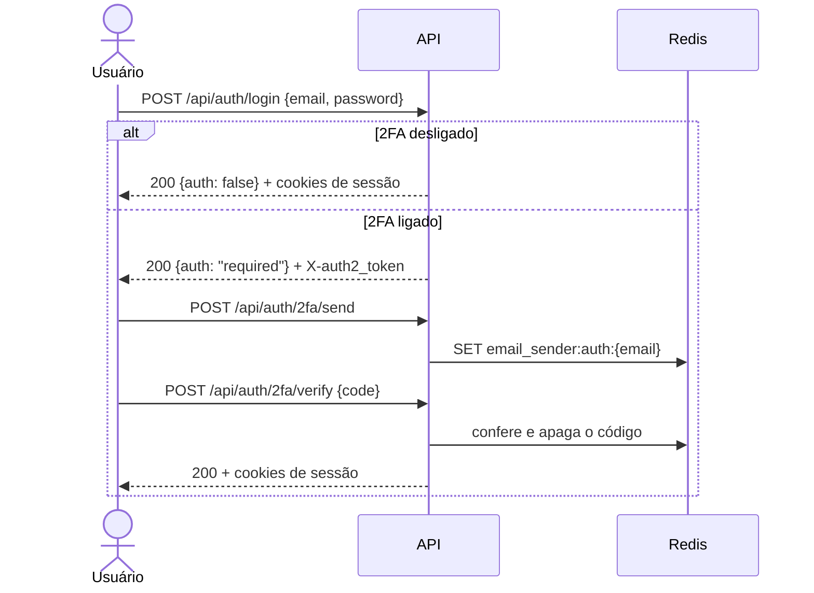
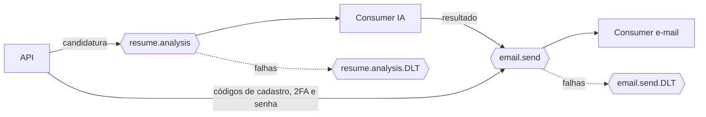
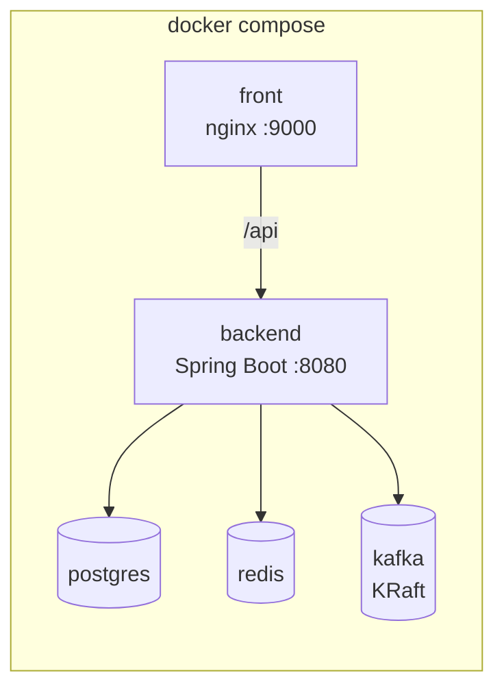

<h1 align="center">RhHub</h1>

<p align="center">
  <strong>Plataforma de recrutamento com triagem de currículos por IA.</strong><br>
  Documentação do back end (Java) e das funcionalidades do front end, baseada no <a href="https://github.com/BrayanDevZN/AgentRH">AgentRH</a>.
</p>

<p align="center">
  
  
  
  
  
</p>

<p align="center">
  
  
  
  
  
  
  
</p>

<p align="center">
  
  
  
</p>

---

## Sumário

1. [Visão geral](#1-visão-geral)
2. [Arquitetura](#2-arquitetura)
3. [Do AgentRH para o RhHub](#3-do-agentrh-para-o-rhhub)
4. [Back end](#4-back-end)
   - [Estrutura de pacotes](#41-estrutura-de-pacotes)
   - [Modelo de dados](#42-modelo-de-dados)
   - [Autenticação e sessão](#43-autenticação-e-sessão)
   - [Papéis e permissões](#44-papéis-e-permissões)
   - [API REST](#45-api-rest)
   - [Mensageria com Kafka](#46-mensageria-com-kafka)
   - [Análise por IA](#47-análise-por-ia)
   - [E-mails](#48-e-mails)
   - [Redis: cache e limites](#49-redis-cache-e-limites)
   - [Regras de validação](#410-regras-de-validação)
   - [Padrão de erros](#411-padrão-de-erros)
   - [Configuração](#412-configuração)
   - [Correções em relação ao AgentRH](#413-correções-em-relação-ao-agentrh)
5. [Front end](#5-front-end)
   - [Funcionalidades por módulo](#51-funcionalidades-por-módulo)
   - [Mapa de telas e rotas](#52-mapa-de-telas-e-rotas)
   - [Matriz tela × endpoint](#53-matriz-tela--endpoint)
   - [Recursos transversais](#54-recursos-transversais)
6. [Integração front e back](#6-integração-front-e-back)
7. [Infraestrutura](#7-infraestrutura)
8. [Roadmap](#8-roadmap)
9. [Pontos em aberto](#9-pontos-em-aberto)

**Legenda de status:**
-brightgreen?style=flat-square)


---

## 1. Visão geral

O RhHub organiza o ciclo de uma candidatura: cadastro e login, publicação de vagas, envio de currículo em PDF, triagem automática por IA e resultado por e-mail. O **back end** (Spring Boot) expõe a API, o **Kafka** executa o trabalho assíncrono e o **front end** (React) é a interface de candidatos e administradores.

| Perfil | O que faz |
| --- | --- |
| **Candidato** (`user`) | Cria conta, vê vagas, envia currículo, acompanha o resultado, gerencia o perfil |
| **Administrador** (`admin`) | Tudo do candidato, mais publicar e editar vagas, ver todas as candidaturas e gerenciar usuários |
| **Admin raiz** | O admin definido em `ADMIN_EMAIL`. É o único que rebaixa admins e exclui contas de terceiros |

Fluxo de uma candidatura:



---

## 2. Arquitetura



| Camada | Responsabilidade | Equivalente no AgentRH |
| --- | --- | --- |
| Controllers | Rotas, validação do corpo, cookies | `src/aplication/handles` + `schema` |
| Services | Regras de negócio e orquestração | `src/service` |
| Security | Hash, JWT, papéis, OAuth | `src/auth` + `dependences` |
| Repositories | Acesso ao banco (JPA) | `src/database/repository` |
| Kafka | Trabalho assíncrono (IA e e-mail) | `src/task` (Celery) |
| Cache | Códigos temporários, rate limit | `src/cache` |
| Integrações | OpenAI e SMTP | `src/utils` |

---

## 3. Do AgentRH para o RhHub

| AgentRH (Python) | RhHub (Java) | Observação |
| --- | --- | --- |
| FastAPI + routers | Spring Web (`@RestController`) | |
| Pydantic | Bean Validation (`@Valid`, records) | |
| SQLAlchemy async + asyncpg | Spring Data JPA + PostgreSQL | Migrações com Flyway |
| bcrypt + PyJWT | `BCryptPasswordEncoder` + jjwt | Cookies `HttpOnly` mantidos |
| Celery + Redis (broker) | **Kafka** com dois topics | Troca principal de arquitetura |
| Redis (cache, códigos) | Spring Data Redis | Mantido |
| `BaseHTTPMiddleware` | `OncePerRequestFilter` | Rate limit global e por usuário |
| OpenAI Responses API | `HttpClient` ou SDK Java | Modelo configurável por variável |
| yagmail | Spring Mail (`JavaMailSender`) | Templates HTML reaproveitados |
| `GET`/`DELETE` com corpo JSON | `POST` ou parâmetros de rota | Navegadores não enviam corpo em `GET` |
| Erros sempre `501` | Códigos HTTP corretos | Ver [seção 4.11](#411-padrão-de-erros) |
| Só login e senha | Login e senha **ou Google OAuth** | Novo |

---

## 4. Back end

### 4.1 Estrutura de pacotes

```
backend/src/main/java/br/rhhub
├── RhHubApplication.java
├── config/            # Security, CORS, Kafka, Redis, propriedades
├── auth/              # JWT, cookies, filtro, OAuth2, 2FA
├── user/              # entidade, repositório, service, controller
├── vacancy/           # vagas
├── resume/            # candidaturas e upload de PDF
├── admin/             # gestão de usuários
├── messaging/         # producers, consumers e DTOs das mensagens
│   ├── analysis/      # topic resume.analysis
│   └── email/         # topic email.send
├── ai/                # cliente OpenAI e leitura do PDF
├── mail/              # JavaMailSender e templates HTML
├── cache/             # códigos temporários e rate limit
└── common/            # erros, DTOs de resposta, utilidades
```

### 4.2 Modelo de dados



- Uma candidatura por usuário e por vaga: restrição única em `(user_id, vacancy_id)`.
- Excluir uma vaga apaga as candidaturas dela (`ON DELETE CASCADE`). Excluir um usuário apaga as dele.
- Os valores de `status` seguem o AgentRH (`aproved`, `recuse`, `pending`) para o front não mudar.
- Novos campos em relação ao AgentRH: `provider`, `google_sub` e `file_name`.



### 4.3 Autenticação e sessão


| Cookie | Conteúdo | Duração | Uso |
| --- | --- | --- | --- |
| `X-user_token` | JWT com `public_id` e expiração | 15 min | Acesso às rotas protegidas |
| `X-user_refresh_token` | JWT de renovação (também guardado no Redis) | 7 dias | Renovar o token de acesso |
| `X-auth2_token` | JWT temporário, só para a etapa do 2FA | 5 min | Entre a senha e o código |

Todos com `HttpOnly`, `SameSite=Strict` e `Secure` em produção. O React nunca lê o token: ele descobre quem está logado com `GET /api/users/me`.

**Cadastro com código por e-mail**



**Login com 2FA opcional**



**Login com Google**

1. O front redireciona para `GET /oauth2/authorization/google`.
2. O Google autentica e volta para `/login/oauth2/code/google`.
3. O back end busca o usuário pelo e-mail verificado. Se existir, **vincula** à mesma conta; se não, cria um com `provider = google`.
4. Emite os mesmos cookies e redireciona para o front. Contas Google **não passam pelo 2FA por e-mail** e não têm troca de senha.

**Recuperar senha:** `POST /api/auth/password/reset-code` envia o código (válido por 8 min) e `POST /api/auth/password/reset` troca a senha.

### 4.4 Papéis e permissões

| Ação | Candidato | Admin | Admin raiz |
| --- | :---: | :---: | :---: |
| Ver vagas | ✅ | ✅ | ✅ |
| Enviar e ver as próprias candidaturas | ✅ | ✅ | ✅ |
| Criar, editar e excluir vagas | ❌ | ✅ | ✅ |
| Ver todas as candidaturas | ❌ | ✅ | ✅ |
| Listar usuários | ❌ | ✅ | ✅ |
| Promover candidato a admin | ❌ | ✅ | ✅ |
| Rebaixar admin | ❌ | ❌ | ✅ |
| Excluir conta de terceiros | ❌ | ❌ | ✅ |

Implementado com `@PreAuthorize("hasRole('ADMIN')")` nos controllers, e uma checagem extra de admin raiz nas ações da última coluna.

### 4.5 API REST

Prefixo `/api`. Respostas em JSON. Sessão por cookie, então o front usa `credentials: "include"`.

**Autenticação e conta**

| Método | Rota | Acesso | Descrição | AgentRH |
| --- | --- | --- | --- | --- |
| `POST` | `/sender/signup-code` | Público | Envia o código de cadastro `{name, email}` | `POST /sender` |
| `POST` | `/users` | Público | Cria a conta `{name, email, cpf, age, gender, password, code}` | `POST /users` |
| `GET` | `/users/me` | Logado | Dados do usuário logado | `GET /users` |
| `PATCH` | `/users/me` | Logado | Altera `age`, `gender` ou `two_factor` `{set, value}` | `PATCH /users` |
| `DELETE` | `/users/me` | Logado | Exclui a própria conta `{password}` | `DELETE /users` |
| `POST` | `/auth/login` | Público | Valida e-mail e senha | `GET /auth` |
| `POST` | `/auth/2fa/send` | Cookie 2FA | Envia o código de 2FA | `POST /sender/2fa` |
| `POST` | `/auth/2fa/verify` | Cookie 2FA | Confere o código e abre a sessão | `GET /auth` com `code` |
| `POST` | `/auth/refresh` | Cookie refresh | Renova o token de acesso | `PUT /auth` |
| `POST` | `/auth/logout` | Logado | Encerra a sessão e invalida o refresh | `DELETE /auth` |
| `PATCH` | `/auth/password` | Logado | Troca a senha `{password, newPassword}` | `PATCH /auth` |
| `POST` | `/auth/password/reset-code` | Público | Envia o código de recuperação `{email}` | `PATCH /sender` |
| `POST` | `/auth/password/reset` | Público | Troca a senha com o código `{email, code, newPassword}` | `PATCH /auth` com `sender` |
| `GET` | `/oauth2/authorization/google` | Público | Inicia o login com Google | novo |

**Vagas**

| Método | Rota | Acesso | Descrição | AgentRH |
| --- | --- | --- | --- | --- |
| `GET` | `/vacancies` | Logado | Lista as vagas (candidato não vê `created_by`) | `GET /vancancies` |
| `GET` | `/vacancies/{id}` | Logado | Detalhe de uma vaga | `GET /vancancies` |
| `POST` | `/vacancies` | Admin | Cria `{name, description}`. Nome único | `POST /vancancies` |
| `PATCH` | `/vacancies/{id}` | Admin | Edita nome e descrição | `PATCH /vancancies` |
| `DELETE` | `/vacancies/{id}` | Admin | Exclui a vaga e as candidaturas dela | `DELETE /vancancies` |

**Candidaturas**

| Método | Rota | Acesso | Descrição | AgentRH |
| --- | --- | --- | --- | --- |
| `POST` | `/resumes` | Logado | Envia o PDF (`multipart`: `vacancyId`, `pdf`). Responde `201` e publica em `resume.analysis` | `POST /resumes` |
| `GET` | `/resumes/me` | Logado | Candidaturas do usuário | `GET /resumes` |
| `GET` | `/resumes` | Admin | Todas as candidaturas (filtro `status`, `vacancyId`) | `GET /resumes` com `get_all` |
| `GET` | `/resumes/{id}` | Dono ou admin | Detalhe e resultado da IA | `GET /resumes` com `id` |
| `GET` | `/resumes/{id}/pdf` | Dono ou admin | Baixa o PDF (`application/pdf`) | PDF em Base64 no JSON |
| `DELETE` | `/resumes/{id}` | Dono ou admin | Exclui a candidatura | `DELETE /resumes` |

**Administração**

| Método | Rota | Acesso | Descrição | AgentRH |
| --- | --- | --- | --- | --- |
| `GET` | `/admin/users` | Admin | Lista os usuários | `GET /admin` com `is_all` |
| `GET` | `/admin/users/{publicId}` | Admin | Busca um usuário | `GET /admin` |
| `PATCH` | `/admin/users/{publicId}/role` | Admin | Define o papel `{role}` | `PATCH /admin` |
| `DELETE` | `/admin/users/{publicId}` | Admin raiz | Exclui o usuário | `DELETE /admin` |

### 4.6 Mensageria com Kafka


Dois topics, cada um com o seu consumer e o seu retry. Eles não se misturam: o consumer da IA, ao terminar, **publica** o resultado em `email.send`. Assim uma falha de SMTP não derruba uma análise já feita.



| Topic | Chave | Produtores | Consumer | Efeito |
| --- | --- | --- | --- | --- |
| `resume.analysis` | `resumeId` | `ResumeService` | `AnalysisConsumer` | Chama a IA, atualiza `status` e `reason`, publica o e-mail |
| `email.send` | e-mail do destinatário | `AnalysisConsumer`, `AuthService` | `EmailConsumer` | Envia o e-mail pelo SMTP |

**Mensagens (JSON)**

```json
// resume.analysis
{ "resumeId": 42 }

// email.send
{ "to": "maria@gmail.com", "subject": "Resultado da sua candidatura", "body": "<html>...</html>" }
```

A mensagem de análise leva só o `resumeId`: o consumer busca o PDF, a vaga e o candidato no banco. Isso evita trafegar o PDF pelo Kafka.

**Confiabilidade**

- **Retry:** `DefaultErrorHandler` com backoff (3 tentativas) e depois envio para o topic `*.DLT`.
- **Idempotência:** o consumer da IA ignora candidaturas que não estejam mais `pending`.
- **Ordem:** a chave `resumeId` mantém as mensagens de uma candidatura na mesma partição.
- **Resultado no banco antes do e-mail:** o status é gravado antes de publicar em `email.send`.

### 4.7 Análise por IA


1. O consumer lê o PDF do banco e **extrai o texto** (Apache PDFBox).
2. Monta a entrada: nome e descrição da vaga, nome do candidato e texto do currículo.
3. Envia à OpenAI com o prompt de triagem (reaproveitado de `src/config/prompt/prompt.md` do AgentRH).
4. A IA devolve uma linha no formato `decisão | assunto | HTML`, em que a decisão é `aproved` ou `recuse`.
5. O consumer separa as três partes, grava `status` e `reason` e publica o HTML em `email.send`.

Com `ENVIRONMENT=test`, a OpenAI é trocada por uma resposta fixa no mesmo formato, e os códigos de e-mail aparecem no JSON para facilitar testes.

### 4.8 E-mails

| Template | Quando é enviado | Origem |
| --- | --- | --- |
| `create_account.html` | Código de cadastro | `/sender/signup-code` |
| `two_factor_authentication.html` | Código de 2FA | `/auth/2fa/send` |
| `update_password.html` | Código de recuperação de senha | `/auth/password/reset-code` |
| `resume_analysis_test.html` | Resultado da análise (modo teste) | Consumer da IA |

O resultado real da análise usa o HTML gerado pela IA. Os templates do AgentRH são reaproveitados em `resources/templates`.

### 4.9 Redis: cache e limites


| Chave | Valor | Duração |
| --- | --- | --- |
| `email_sender:create:{email}` | Código de cadastro | 15 min |
| `email_sender:auth:{email}` | Código de 2FA | 5 min |
| `user_sender:update:{email}` | Código de recuperação de senha | 8 min |
| `refresh:{publicId}` | Refresh token vigente | 7 dias |
| `rate_limit:{ip ou token}` | Contador de requisições | 60 s |
| `global_rate_limit` | Contador global | 60 s |

**Rate limit** (`RateLimitFilter`):

- Rotas públicas (cadastro, login, envio de código) contam por **IP**; as demais, por **token**.
- Ao passar do limite, a resposta é `429 Too Many Requests`.
- Limites configuráveis em `RATE_LIMIT` e `GLOBAL_RATE_LIMIT`.
- Códigos de verificação têm no máximo **5 tentativas**.

### 4.10 Regras de validação

| Campo | Regra |
| --- | --- |
| `email` | E-mail válido (no AgentRH era só `@gmail.com`, com 8 caracteres antes do `@`) |
| `password` | Mínimo de 8 caracteres, com maiúscula, minúscula e número |
| `cpf` | Exatamente 11 dígitos, único |
| `age` | 18 ou mais |
| `gender` | `male`, `female` ou `other` |
| `code` | 6 dígitos (no AgentRH eram 5) |
| `pdf` | `application/pdf`, tamanho máximo configurável |
| `vacancy.name` | Único |

### 4.11 Padrão de erros

No AgentRH todo erro virava `501`. Aqui cada caso tem o seu código:

| Código | Quando |
| --- | --- |
| `400` | Corpo inválido ou campo fora da regra |
| `401` | Sem sessão, token expirado, credencial ou código inválido |
| `403` | Sem permissão para a ação |
| `404` | Recurso não encontrado |
| `409` | Já existe (e-mail, vaga ou candidatura duplicada) |
| `422` | Regra de negócio violada |
| `429` | Rate limit excedido |
| `500` | Erro inesperado (sem detalhes internos na resposta) |

```json
{ "status": 409, "error": "Conflict", "message": "Você já se candidatou a essa vaga.", "path": "/api/resumes" }
```

### 4.12 Configuração

| Variável | Descrição |
| --- | --- |
| `DATABASE_URL`, `DATABASE_USER`, `DATABASE_PASSWORD` | PostgreSQL |
| `REDIS_HOST`, `REDIS_PORT`, `REDIS_PASSWORD` | Redis |
| `KAFKA_BOOTSTRAP_SERVERS` | Endereço do Kafka |
| `JWT_SECRET` | Chave de assinatura dos tokens (`sing` no AgentRH) |
| `FRONTEND_ORIGIN` | Origem liberada no CORS (`origin` no AgentRH) |
| `RATE_LIMIT`, `GLOBAL_RATE_LIMIT` | Limites por minuto |
| `ADMIN_EMAIL`, `ADMIN_PASSWORD` | Admin raiz criado na primeira execução (`email_user` e `password_user`) |
| `MAIL_HOST`, `MAIL_PORT`, `MAIL_USER`, `MAIL_PASSWORD` | SMTP |
| `OPENAI_API_KEY`, `OPENAI_MODEL` | IA |
| `GOOGLE_CLIENT_ID`, `GOOGLE_CLIENT_SECRET` | Login com Google |
| `ENVIRONMENT` | `test` troca a IA por resposta fixa e expõe os códigos |

### 4.13 Correções em relação ao AgentRH

Problemas encontrados lendo o código original, que **não** devem ser repetidos:

| # | Problema no AgentRH | Correção no RhHub |
| --- | --- | --- |
| 1 | `GET` e `DELETE` recebem corpo JSON, que navegadores não enviam | Rotas de recurso e `POST` para ações |
| 2 | Todo erro responde `501` | Códigos HTTP corretos ([4.11](#411-padrão-de-erros)) |
| 3 | A checagem de admin em `dependences/util.py` compara `self.user != "admin"` (um `dict` com uma `str`) e `required == "*"` (com uma lista), então **nunca bloqueia** `/admin`. `GET /admin` lista usuários para qualquer logado | `@PreAuthorize` em todas as rotas de administração |
| 4 | O login sem 2FA usa `token_auth`, que só existe no ramo do cookie, e quebra | Fluxo único que emite os cookies de sessão |
| 5 | O refresh lê `payload["expire"]`, que o token de refresh não tem (ele só guarda `created_at`), e ainda exige que o token de acesso **não** esteja expirado | Refresh com expiração própria, validado contra o token guardado no Redis |
| 6 | Cookie `X-user_refresh-token` (com hífen) em `/users` e `X-user_refresh_token` nas outras rotas | Um só nome, com underscore |
| 7 | `DELETE /vancancies` chama `update` antes de excluir | Exclusão direta por `id` |
| 8 | `sender_update` passa um objeto no lugar do e-mail e troca o nome por `replace` no HTML | Busca por e-mail e templates com variáveis |
| 9 | O consumer faz `resume.decode("utf-8")` em bytes de PDF, o que falha em PDFs reais | Extração de texto com PDFBox |
| 10 | Rate limit: quando o contador é igual ao limite, a requisição passa | Comparação com `>=` |
| 11 | Código de 5 dígitos, sem limite de tentativas | 6 dígitos e no máximo 5 tentativas |

---

## 5. Front end


Código em `src/frontend`. Hoje roda sobre uma **API simulada** (`src/lib/api.ts`), em que cada função documenta a rota real. Qualquer e-mail, senha e código são aceitos, e e-mails com `admin` entram como administrador.

### 5.1 Funcionalidades por módulo

#### Autenticação

| Funcionalidade | Status | Detalhe |
| --- | --- | --- |
| Login com e-mail e senha |  | `POST /auth/login` |
| Login com Google | -brightgreen?style=flat-square) | Hoje entra direto; no real redireciona para o Google |
| Verificação em duas etapas |  | Campo de 6 dígitos (`InputOTP`) |
| Cadastro com código por e-mail |  | Duas etapas: dados e código |
| Esqueci a senha |  | Diálogo com e-mail, código e nova senha |
| Sair |  | Menu do usuário |
| Renovação automática da sessão |  | Ao receber `401`, chamar `POST /auth/refresh` e repetir a requisição |
| Validação de senha em tempo real |  | Indicador das regras ao digitar |

#### Painel

| Funcionalidade | Status |
| --- | --- |
| Saudação com cena 3D |  |
| Números: vagas abertas, candidaturas, em análise, aprovadas |  |
| Candidaturas recentes com status |  |
| Atualização automática enquanto há análise em andamento |  |

#### Vagas

| Funcionalidade | Perfil | Status |
| --- | --- | --- |
| Listar vagas em cartões | Todos |  |
| Buscar por nome ou descrição | Todos |  |
| Candidatar-se enviando PDF | Todos |  |
| Ver o status quando já se candidatou | Todos |  |
| Criar vaga | Admin |  |
| Editar vaga | Admin |  |
| Excluir vaga (com confirmação) | Admin |  |
| Paginação | Todos |  |

#### Minhas candidaturas

| Funcionalidade | Status | Detalhe |
| --- | --- | --- |
| Tabela com vaga, arquivo, data e status |  | |
| Ver o resultado da IA |  | Desabilitado enquanto `pending` |
| Baixar o PDF enviado |  | Trocar o Base64 por `GET /resumes/{id}/pdf` |
| Excluir candidatura |  | Com confirmação |
| Atualização automática do status |  | Consulta a cada 2 s enquanto houver `pending` |

#### Perfil

| Funcionalidade | Status |
| --- | --- |
| Ver nome, e-mail, CPF, papel e forma de login |  |
| Editar idade e gênero |  |
| Ligar e desligar o 2FA |  |
| Trocar a senha (contas locais) |  |
| Excluir a conta com confirmação de senha |  |
| Completar CPF e idade em contas Google |  |

#### Administração

| Funcionalidade | Status | Detalhe |
| --- | --- | --- |
| Listar usuários com papel e forma de login |  | |
| Tornar admin e remover admin |  | Só o admin raiz rebaixa; esconder a ação para os demais |
| Excluir usuário |  | Só o admin raiz; com confirmação |
| Ver todas as candidaturas |  | |
| Filtrar por status |  | Todas, em análise, aprovado, recusado |
| Filtrar por vaga |  | |

### 5.2 Mapa de telas e rotas

| Rota | Tela | Acesso |
| --- | --- | --- |
| `/login` | Entrar, 2FA e recuperar senha | Público |
| `/cadastro` | Criar conta | Público |
| `/` | Painel | Logado |
| `/vagas` | Vagas | Logado |
| `/candidaturas` | Minhas candidaturas | Logado |
| `/perfil` | Perfil (dados, segurança, conta) | Logado |
| `/admin/usuarios` | Gestão de usuários | Admin |
| `/admin/candidaturas` | Todas as candidaturas | Admin |

Quem está logado e abre `/login` vai para `/`; quem não está logado vai para `/login`; um candidato em rota de admin volta para `/`.

### 5.3 Matriz tela × endpoint

| Tela | Endpoints usados |
| --- | --- |
| Login | `POST /auth/login`, `POST /auth/2fa/send`, `POST /auth/2fa/verify`, `GET /oauth2/authorization/google`, `POST /auth/password/reset-code`, `POST /auth/password/reset` |
| Cadastro | `POST /sender/signup-code`, `POST /users` |
| Painel | `GET /vacancies`, `GET /resumes/me` |
| Vagas | `GET /vacancies`, `GET /resumes/me`, `POST /resumes`, `POST` `PATCH` `DELETE /vacancies` (admin) |
| Minhas candidaturas | `GET /resumes/me`, `GET /vacancies`, `GET /resumes/{id}/pdf`, `DELETE /resumes/{id}` |
| Perfil | `GET /users/me`, `PATCH /users/me`, `PATCH /auth/password`, `DELETE /users/me` |
| Admin: usuários | `GET /admin/users`, `PATCH /admin/users/{id}/role`, `DELETE /admin/users/{id}` |
| Admin: candidaturas | `GET /resumes`, `GET /vacancies`, `GET /admin/users` |
| Layout | `GET /users/me`, `POST /auth/logout` |

### 5.4 Recursos transversais

| Recurso | Status |
| --- | --- |
| Tema escuro com tokens semânticos do shadcn |  |
| Layout responsivo com barra lateral recolhível |  |
| Elementos 3D (three.js) nas telas de entrada e no painel |  |
| Avisos (toast) de sucesso e erro |  |
| Estados de carregamento (skeleton e spinner) e de lista vazia |  |
| Rotas protegidas por sessão e por papel |  |
| Tratamento do `429` (rate limit) com mensagem própria |  |
| Tema claro |  |

---

## 6. Integração front e back

Para trocar a API simulada pela real, só o corpo de cada função em `src/lib/api.ts` muda. As telas ficam como estão.

| Ponto | O que fazer |
| --- | --- |
| Chamadas | `fetch` com `credentials: "include"` e base `/api` |
| CORS | O back end libera `FRONTEND_ORIGIN` com `allowCredentials(true)` |
| Cookies entre domínios | Em produção, servir front e API no **mesmo domínio** (proxy do nginx em `/api`) por causa do `SameSite=Strict` |
| Nomes de campos | O front usa `vancancie_id` e `/vancancies` (grafia do AgentRH). Trocar por `vacancy_id` e `/vacancies` em `types.ts` e `api.ts` |
| PDF | Remover o campo `pdf` em Base64 de `Resume` e usar `GET /resumes/{id}/pdf` |
| Papel de admin | Ler `role` de `GET /users/me`. Esconder, para admins que não são raiz, as ações de rebaixar e excluir |
| 2FA | O código vem só por e-mail. Remover o aviso "Simulação: o código é..." |
| Login com Google | Trocar `loginWithGoogle()` por `window.location.href = "/oauth2/authorization/google"` |
| Aviso de demonstração | Remover do login o texto sobre e-mails com `admin` |
| Renovação | Interceptar o `401`, chamar `POST /auth/refresh` e repetir a requisição |

---

## 7. Infraestrutura



| Serviço | Imagem | Observação |
| --- | --- | --- |
| `front` | `Dockerfile.front` (Node para o build, nginx para servir) | Porta 9000 |
| `backend` | Imagem do Spring Boot | Consumers no mesmo app |
| `postgres` | `postgres:16` | O AgentRH não incluía o banco no Compose |
| `redis` | `redis:alpine` | |
| `kafka` | `apache/kafka` em modo KRaft | Sem Zookeeper. Topics criados na subida |

O `Dockerfile.front` já existe e o `railway.json` aponta para ele no deploy.

---

## 8. Roadmap

- [x] Front end com autenticação, vagas, candidaturas, perfil e admin (API simulada)
- [x] Dockerfile do front end e deploy
- [ ] Back end: projeto Spring Boot, entidades e migrações Flyway
- [ ] Autenticação: cadastro com código, login, cookies JWT, refresh e logout
- [ ] 2FA por e-mail e recuperação de senha
- [ ] Login com Google (OAuth2)
- [ ] CRUD de vagas e controle de papéis
- [ ] Upload de candidaturas e download do PDF
- [ ] Kafka: topics `resume.analysis` e `email.send`, retry e DLT
- [ ] Análise por IA com leitura de PDF
- [ ] Rate limit com Redis
- [ ] Docker Compose completo (front, back, Postgres, Redis, Kafka)
- [ ] Testes unitários, de integração (Testcontainers) e funcionais
- [ ] Trocar a API simulada do front pela real

---

## 9. Pontos em aberto

1. **CPF em contas Google:** o Google não fornece CPF, idade nem gênero. O front mostra "Não informado" e não deixa editar o CPF. É preciso um endpoint para completar o cadastro.
2. **Tipos de arquivo:** aceitar só PDF ou também DOCX?
3. **E-mail:** manter a restrição a `@gmail.com` do AgentRH ou aceitar qualquer e-mail válido?
4. **Duração do token de acesso:** 15 minutos com refresh (proposto) ou 7 dias, como no original?
5. **Vários admins raiz:** hoje só um (`ADMIN_EMAIL`). Vale permitir mais de um?
6. **Reenvio de código:** limite de reenvios por e-mail e por IP.
7. **Paginação** de vagas e de candidaturas no admin, quando houver volume.
