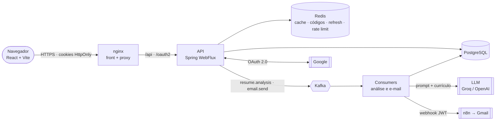
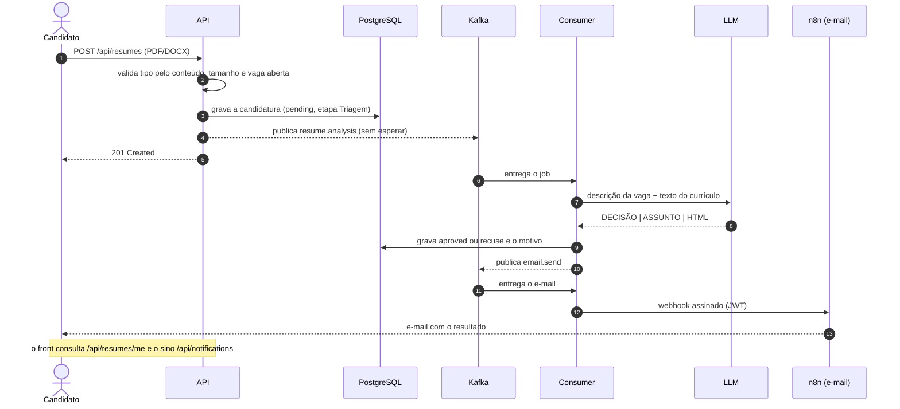
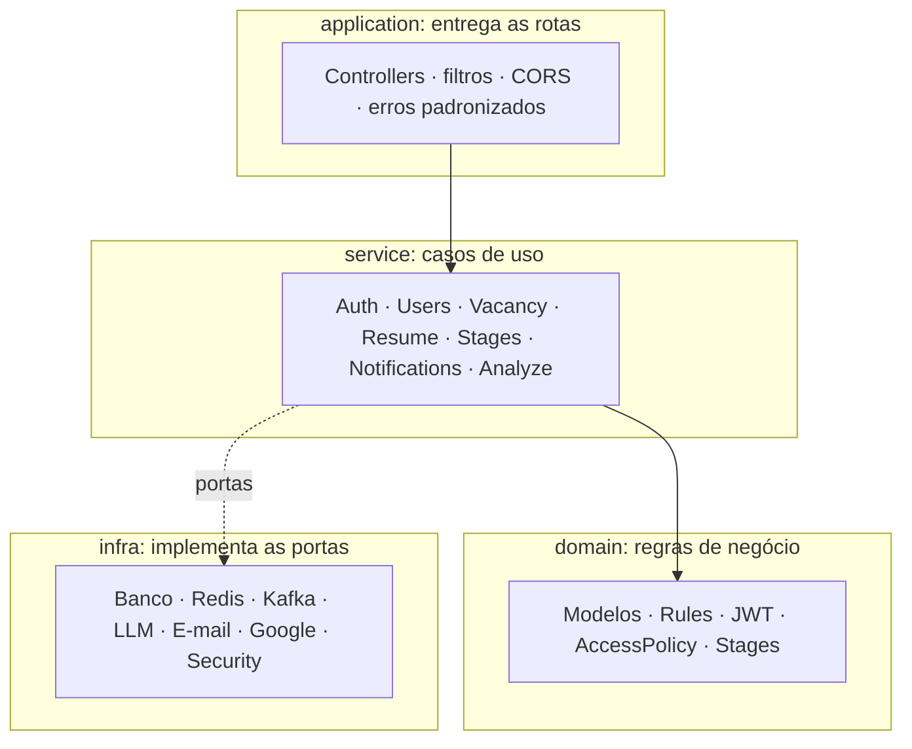
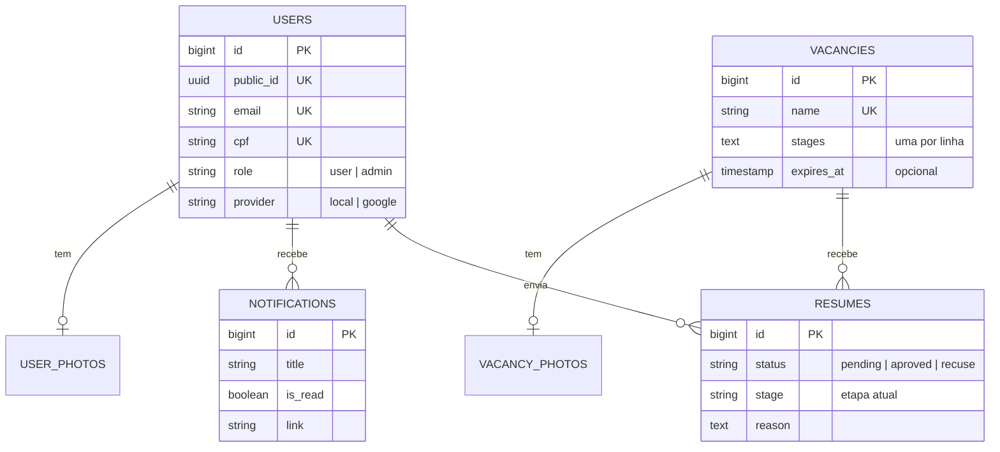

<div align="center">

# rhhub.

**Recrutamento com análise de currículos feita por IA.**
Publique vagas, receba candidaturas, acompanhe cada etapa do processo seletivo e deixe a triagem inicial por conta da inteligência artificial.

[](https://github.com/BrayanDevZN/RhHub/actions/workflows/ci.yml)


[Visão geral](#-visão-geral) ·
[Funcionalidades](#-funcionalidades) ·
[Arquitetura](#-arquitetura) ·
[Tecnologias](#-tecnologias) ·
[Como rodar](#-como-rodar) ·
[Testes](#-testes) ·
[Deploy](#-deploy) ·
[Documentação](#-documentação)

</div>

---

## 📌 Visão geral

O **RhHub** é uma plataforma de recrutamento com dois papéis:

- **Candidato:** cria a conta (e-mail e senha ou Google), escolhe uma vaga, envia o currículo em PDF ou DOCX e acompanha o resultado e a etapa em que está, com avisos por e-mail e dentro do app.
- **Administrador:** publica e edita vagas, define as etapas do processo, vê quantos candidatos cada vaga tem e move os aprovados de etapa.

Quando um currículo chega, ele **não é analisado na hora da requisição**: vai para uma fila (Kafka), um consumidor extrai o texto, pergunta à IA se o candidato combina com a vaga, grava o resultado e dispara o e-mail. Assim o envio responde rápido, e uma falha da IA ou do e-mail não perde a candidatura.

O RhHub é a evolução do [AgentRH](https://github.com/BrayanDevZN/AgentRH) (back end em Python/FastAPI), reescrito em Java com acesso a dados totalmente assíncrono e com um front end novo.

## ✨ Funcionalidades

| Área | O que faz |
|---|---|
| **Autenticação** | Cadastro com código por e-mail, login com e-mail e senha, **2FA opcional** por e-mail, recuperação de senha e login/cadastro com **Google**. Sessão por cookies `HttpOnly`, com renovação por refresh token |
| **Conta** | CPF, idade e gênero obrigatórios (o Google pede num passo extra após o cadastro), foto de perfil (JPEG, PNG ou WebP até 2 MB), exclusão da conta |
| **Vagas** | Nome único, descrição, requisitos e responsabilidades, foto de capa, **data de expiração opcional**, contador de candidatos (para admins) |
| **Etapas do processo** | Por padrão *Triagem → Entrevista → Contratado*. Só a **Triagem é obrigatória**; o admin remove, troca ou acrescenta etapas |
| **Candidaturas** | Upload validado pelo conteúdo do arquivo, uma candidatura por vaga, análise da IA em segundo plano, resultado `pending`, `aproved` ou `recuse` |
| **Notificações** | E-mail a cada resultado e mudança de etapa, e **sino dentro do app** com contador de não lidos, lista e atalho para o assunto |
| **Administração** | Gestão de usuários e papéis, visão de todas as candidaturas, admin raiz criado na subida |
| **Segurança** | BCrypt (custo 12), JWT HS256, CORS restrito, cabeçalhos de segurança, **rate limit por IP** no Redis |

## 🏗️ Arquitetura

### Visão de ponta a ponta



O navegador só conversa com o domínio do front. O nginx serve os arquivos estáticos e **repassa** `/api`, `/oauth2` e `/login/oauth2` para a API, o que mantém os cookies `SameSite` no mesmo site.

### O que acontece quando um candidato envia o currículo



Se o Kafka estiver fora na hora do envio, a candidatura continua `pending` e o `PendingResumeRepublisher` a reenfileira depois. Jobs que falham repetidamente vão para uma **dead letter queue** gravada no banco.

### Arquitetura em camadas do back end



| Camada | Responsabilidade |
|---|---|
| `application` | **Só onde a aplicação e as rotas começam.** Recebe a requisição HTTP e devolve a resposta: `controllers` (as rotas `/api`), `middleware` (login, limite de requisições, cabeçalhos de segurança), `cors`, `handlers` (traduz erros para HTTP), `dto` (formato do JSON) e `utils`. Não tem regra de negócio |
| `service` | **As regras de negócio.** Um serviço por assunto (autenticação, vagas, candidaturas, análise, avisos...). Orquestra o `domain` e fala com o mundo de fora só por interfaces. Não conhece Spring, banco nem rede. O `usecase` tem os dois casos que os consumidores de fila chamam |
| `domain` | **O núcleo.** Os objetos do sistema (`User`, `Vacancy`, `Resume`...), as validações (`Rules`, `Stages`), o JWT e a política de acesso, e os erros de negócio. Não depende de nenhuma outra camada |
| `infra` | **Tudo que conecta com dados e serviços externos.** Contém as interfaces do que o sistema precisa (`repository`, `integration`, `store`) e as implementações: banco (`database`), cache e Redis (`cache`, `redis`), Kafka (`messaging`), IA (`llm`), e-mail (`email`), Google (`google`), leitura de PDF/DOCX (`document`), senha (`security`) e configuração (`config`) |

O fluxo de uma requisição é `application` → `service` → `domain` + portas → `infra`. Isso permite testar os serviços com repositórios em memória e trocar uma implementação (por exemplo, o provedor de IA) sem mexer nas regras.

### O que cada arquivo do back end faz

O código fica em `src/backend/src`. A tabela abaixo está agrupada por pasta, na ordem em que uma requisição atravessa o sistema. Cada método dentro dos arquivos também tem comentário explicando o que faz.

**Entrada da aplicação:** `RhHubApplication` inicia o Spring Boot. O mesmo jar roda a API e o consumer; a variável `KAFKA_CONSUMERS_ENABLED` decide se ele lê as filas (consumer) ou só publica nelas (API).

#### `application/controllers`: onde cada rota começa

Recebem a requisição HTTP, chamam um serviço e devolvem a resposta. Não têm regra de negócio.

| Arquivo | O que faz |
|---|---|
| `AdminController` | `/api/admin/users`: o administrador lista, consulta, muda o papel, apaga usuários e vê a foto deles |
| `AuthController` | `/api/auth`: login, 2FA, renovar sessão (refresh), logout, trocar e recuperar senha, e quais logins externos estão ligados |
| `GoogleController` | Login com Google: começa o fluxo (`/oauth2/authorization/google`) e trata a volta (`/login/oauth2/code/google`) |
| `HealthController` | `/api/health`: responde "ok" para a plataforma saber que a API está de pé |
| `NotificationController` | `/api/notifications`: o sino, com listar avisos, marcar um ou todos como lidos |
| `ResumeController` | `/api/resumes`: enviar currículo, listar, ver, baixar o arquivo, mover de etapa e apagar |
| `UserController` | `/api/users` e `/api/sender`: cadastro com código por e-mail, perfil (`/me`), foto e exclusão da própria conta |
| `VacancyController` | `/api/vacancies`: listar, ver, criar, editar e apagar vagas, e a foto da vaga |

#### `application/middleware`: roda antes de toda rota

Filtros que cada requisição atravessa antes de chegar ao controller, nesta ordem.

| Arquivo | O que faz |
|---|---|
| `SecurityHeadersFilter` | Põe cabeçalhos de segurança em toda resposta (sem iframe, sem adivinhar tipo de arquivo, sem referrer) |
| `AuthFilter` | Exige o cookie com o JWT em tudo que é `/api` (menos as rotas públicas) e guarda quem é o usuário na requisição |
| `RateLimitFilter` | Limita requisições por minuto: por IP nas rotas públicas, por usuário nas logadas, mais um contador global |

#### `application/cors`

| Arquivo | O que faz |
|---|---|
| `CorsConfig` | Define de quais endereços de front a API aceita chamadas (`FRONTEND_URL`), com cookies |

#### `application/handlers`

| Arquivo | O que faz |
|---|---|
| `ApiExceptionHandler` | Transforma qualquer erro em JSON `{status, error, message, path}` com o código HTTP certo; erro inesperado vira 500 sem detalhe interno |

#### `application/dto`

| Arquivo | O que faz |
|---|---|
| `Views` | Formato do JSON que vai para o front (usuário, vaga, candidatura, avisos). Nunca inclui hash de senha nem id do Google |

#### `application/utils`

| Arquivo | O que faz |
|---|---|
| `WebSupport` | Ferramentas das rotas: cookies de sessão, descobrir quem está logado, ler upload com limite de tamanho e converter ids |

#### `service`: as regras de negócio (casos de uso)

Cada serviço cuida de um assunto, orquestra o `domain` e fala com o mundo de fora só pelas interfaces. Não conhecem Spring, banco nem rede.

| Arquivo | O que faz |
|---|---|
| `AuthService` | Cadastro, login (com 2FA opcional), refresh, logout, troca e recuperação de senha, login com Google e criação do admin raiz |
| `UserService` | A conta do próprio usuário: ver, alterar perfil, completar cadastro, ligar 2FA e excluir a conta |
| `AdminService` | Administração de usuários: listar, mudar papel e excluir, seguindo a política de permissões |
| `VacancyService` | Vagas: listar, ver, criar, editar e apagar (só admin), com etapas, prazo de expiração e foto |
| `ResumeService` | Candidaturas: validar e gravar o currículo como `pending`, pedir a análise em segundo plano, listar, baixar e apagar |
| `ResumeStageService` | Mover uma candidatura aprovada de etapa (só admin); o candidato recebe e-mail e aviso |
| `AnalyzeResumeService` | A análise: lê o currículo, monta a pergunta para a IA, grava o resultado, enfileira o e-mail e cria o aviso |
| `DeliverEmailService` | Entrega à implementação de envio o e-mail que veio da fila |
| `NotificationService` | O sino do app: listar avisos, marcar como lidos e criar avisos para usuários ou administradores |
| `ProfilePhotoService` | Foto de perfil: o dono troca e remove; o dono e os admins veem |
| `AsyncPasswordHasher` | Faz o hash BCrypt fora da thread do servidor (leva ~250 ms de CPU) para não travar outras requisições |

#### `service/usecase`

Os dois casos de uso que os consumidores de fila chamam.

| Arquivo | O que faz |
|---|---|
| `AnalyzeResume` | Interface do caso de uso "analisar uma candidatura" (implementado por `AnalyzeResumeService`) |
| `DeliverEmail` | Interface do caso de uso "entregar um e-mail" (implementado por `DeliverEmailService`) |

#### `domain/model`: os objetos do sistema

Dados e regras simples sobre eles. Não dependem de nada externo.

| Arquivo | O que faz |
|---|---|
| `User` | A conta: dados pessoais, papel, provedor (local ou Google), hash de senha. Métodos `with...` devolvem cópias alteradas |
| `Vacancy` | A vaga: nome, descrição, requisitos, responsabilidades, etapas, prazo e quantos candidatos tem |
| `Resume` | A candidatura: quem, qual vaga, situação (`pending`, `aproved`, `recuse`), motivo e etapa. O arquivo não viaja aqui |
| `ResumeFile` | O arquivo de um currículo (bytes, nome e tipo), usado no download |
| `ResumeStatus` | As situações da candidatura e a regra de quais mudanças são permitidas (só sai de `pending`) |
| `AnalysisResult` | A resposta da IA já interpretada (`DECISÃO | ASSUNTO | HTML`), com a conversão do HTML em texto para o motivo |
| `Notification` | Um aviso do sino |
| `ProfilePhoto` | Uma foto (perfil ou vaga): descobre o tipo pelo conteúdo e limita a 2 MB |
| `DocumentType` | Tipos de currículo aceitos: PDF e DOCX |
| `DeadLetter` | O registro de uma mensagem do Kafka que falhou de vez |
| `DeadLetterStatus` | Situação da falha: `failed` ou `resolved` |
| `Role` | Papel: `user` (candidato) ou `admin` (RH) |
| `AuthProvider` | Como a conta foi criada: `local` ou `google` |
| `Gender` | Gênero do cadastro: `male`, `female` ou `other` |

#### `domain/rule`

| Arquivo | O que faz |
|---|---|
| `Rules` | Validação e normalização dos campos: e-mail `@gmail.com`, senha, nome, CPF, idade, gênero, código, textos da vaga |
| `Stages` | Etapas do processo seletivo: a Triagem é obrigatória e sempre a primeira; o padrão é Triagem, Entrevista e Contratado |

#### `domain/auth`

| Arquivo | O que faz |
|---|---|
| `JwtService` | Emite e confere os tokens de sessão (HS256): assinatura, validade e tipo |
| `TokenType` | Os 3 tokens: acesso (15 min), refresh (7 dias) e 2FA (5 min), cada um com seu cookie |
| `TokenClaims` | O que um token válido carrega: usuário, tipo, id e datas |
| `AccessPolicy` | Quem pode o quê: promover, rebaixar e excluir; define o admin raiz (o e-mail de `ADMIN_EMAIL`) |
| `CodeGenerator` | Gera o código de 6 dígitos com `SecureRandom` |
| `CodePurpose` | Para que serve o código (cadastro, 2FA ou troca de senha): chave no Redis e validade |
| `PasswordHasher` | Interface do hash de senha (a implementação BCrypt fica em `infra/security`) |

#### `domain/exception`

| Arquivo | O que faz |
|---|---|
| `DomainException` | Os erros de negócio (400, 401, 403, 404, 409, 422 e 429), que o `ApiExceptionHandler` traduz para HTTP |

#### `infra/repository`: interfaces de acesso a dados

O que o sistema precisa para ler e gravar dados. As implementações estão em `infra/database` (SQL) e `infra/cache` (com Redis na frente).

| Arquivo | O que faz |
|---|---|
| `UserRepository` | Usuários: buscar por id, e-mail, Google ou CPF, salvar e apagar; leitura rápida da identidade de quem está logado |
| `VacancyRepository` | Vagas: buscar, listar, salvar, apagar e conferir nome repetido |
| `ResumeRepository` | Candidaturas: buscar, listar com filtros, ler o arquivo, criar, mudar resultado e etapa, apagar |
| `NotificationRepository` | Avisos: criar, listar, contar não lidos e marcar como lidos |
| `ProfilePhotoRepository` | Foto de perfil: uma por usuário |
| `VacancyPhotoRepository` | Foto da vaga: uma por vaga |
| `DeadLetterRepository` | Mensagens que falharam de vez: gravar (sem duplicar), consultar e marcar como resolvida |

#### `infra/integration`: interfaces de serviços de fora

O que o sistema precisa de fora do banco. As implementações estão em `infra/llm`, `infra/email`, `infra/google`, `infra/document` e `infra/messaging`.

| Arquivo | O que faz |
|---|---|
| `AiProvider` | Pede uma resposta a um modelo de IA |
| `EmailSender` | Envia um e-mail |
| `EmailMessage` | Um e-mail pronto: destinatário, assunto, corpo e tipo (HTML ou texto) |
| `EmailComposer` | Monta os e-mails do sistema (código de verificação e mudança de etapa) |
| `EmailPublisher` | Coloca um e-mail na fila |
| `ResumeAnalysisPublisher` | Coloca uma candidatura na fila de análise |
| `GoogleIdentityProvider` | Login com Google: monta o endereço de autorização e lê o perfil |
| `DocumentTextExtractor` | Descobre o tipo do arquivo (PDF ou DOCX) e extrai o texto |
| `Notifier` | Cria os avisos do sino sem nunca derrubar a ação principal |

#### `infra/store`: interfaces do Redis

| Arquivo | O que faz |
|---|---|
| `RateLimiter` | Conta requisições por minuto |
| `RefreshTokenStore` | Guarda o refresh token vigente de cada usuário, para poder encerrar a sessão |
| `VerificationCodeStore` | Códigos de 6 dígitos por e-mail: validade, um por minuto e no máximo 5 tentativas |

#### `infra/database`: conexão com o banco

PostgreSQL em produção (assíncrono, R2DBC) ou SQLite local.

| Arquivo | O que faz |
|---|---|
| `DatabaseConfig` | Escolhe e cria o banco a partir de `DATABASE_URL` e cria as tabelas na subida |
| `DatabaseUrl` | Interpreta a `DATABASE_URL` (host, porta, usuário, senha, SSL) ou escolhe o SQLite se vier vazia |
| `SqlExecutor` | Interface para executar SQL: consulta (devolve linhas) e comando (devolve quantas mudaram) |
| `PostgresSqlExecutor` | Executa SQL no PostgreSQL sem bloquear, com pool de conexões |
| `SqliteSqlExecutor` | Executa SQL no SQLite numa thread própria, uma operação por vez |
| `Params` | Parâmetros nomeados de uma consulta (o tipo importa quando o valor é nulo) |
| `Row` | Uma linha do resultado, com leitura de texto, número, UUID, data, booleano e bytes nos dois bancos |

#### `infra/database/adapter`

Escrevem o SQL de cada repositório. Todos funcionam igual no PostgreSQL e no SQLite.

| Arquivo | O que faz |
|---|---|
| `UserRepositoryAdapter` | SQL dos usuários; erro de unicidade vira "e-mail/CPF/Google já cadastrado" |
| `VacancyRepositoryAdapter` | SQL das vagas, já calculando se têm foto e quantos candidatos |
| `ResumeRepositoryAdapter` | SQL das candidaturas; as consultas comuns não trazem o arquivo (que é pesado) |
| `NotificationRepositoryAdapter` | SQL dos avisos |
| `ProfilePhotoRepositoryAdapter` | SQL da foto de perfil (inserir ou trocar) |
| `VacancyPhotoRepositoryAdapter` | SQL da foto da vaga (inserir ou trocar) |
| `DeadLetterRepositoryAdapter` | SQL das falhas do Kafka; a origem é única, então não duplica |

#### `infra/database/table`

Criam as tabelas na subida (`CREATE TABLE IF NOT EXISTS`), sem ferramenta de migração.

| Arquivo | O que faz |
|---|---|
| `TableCreator` | Cria as tabelas que faltam, na ordem das chaves estrangeiras, e acrescenta colunas novas em bancos antigos |
| `TableDefinition` | Interface de uma tabela: nome, comandos de criação e colunas acrescentadas depois |
| `Dialect` | Os tipos de coluna de cada banco, para escrever a tabela uma vez só |
| `UsersTable` | Tabela `users` |
| `UserPhotosTable` | Tabela `user_photos` |
| `VacanciesTable` | Tabela `vacancies` |
| `VacancyPhotosTable` | Tabela `vacancy_photos` |
| `ResumesTable` | Tabela `resumes` (candidatura e arquivo) |
| `NotificationsTable` | Tabela `notifications` |
| `DeadLettersTable` | Tabela `dead_letters` |

#### `infra/cache`: cache com Redis

Cache-aside: lê do cache, senão do banco e guarda; ao alterar, apaga. Se o Redis cair, a leitura segue pelo banco.

| Arquivo | O que faz |
|---|---|
| `QueryCache` | O mecanismo do cache-aside, com limite de 300 ms e pausa de 30 s se o Redis falhar |
| `CacheStore` | Interface do armazenamento do cache (texto com prazo) |
| `RedisCacheStore` | Implementação no Redis; apaga por prefixo com SCAN, sem travar o servidor |
| `CacheKeys` | Chaves e prazos do cache num lugar só (5 min e 60 s) |
| `CachedUserRepository` | Guarda a identidade de quem está logado; nunca guarda hash de senha |
| `CachedVacancyRepository` | Guarda a lista e cada vaga; salvar ou apagar limpa tudo |
| `CachedNotificationRepository` | Guarda a lista e o contador do sino de cada usuário |
| `CachedResumeRepository` | Não guarda candidaturas (mudam o tempo todo); só limpa o cache das vagas quando o número de candidatos muda |

#### `infra/redis`: o que o Redis guarda além do cache

| Arquivo | O que faz |
|---|---|
| `RedisConfig` | Conexão com o Redis, teste de conexão na subida |
| `RedisStore` | Operações básicas do Redis, incluindo o contador atômico com expiração |
| `RedisRateLimiter` | Implementa o limite de requisições por minuto |
| `RedisRefreshTokenStore` | Implementa a guarda do refresh token (`refresh:<usuário>`) |
| `RedisVerificationCodeStore` | Implementa os códigos de verificação, com a regra de 5 tentativas |

#### `infra/messaging`: Kafka

As filas `resume.analysis` e `email.send`, com tentativas, dead letter e reenvio.

| Arquivo | O que faz |
|---|---|
| `KafkaConfig` | Conexão, produtor, consumidor, criação dos tópicos e a política de erro (tentativas e dead letter) |
| `KafkaTopics` | Nomes dos tópicos, grupos de consumo e do tópico `.DLT` de cada um |
| `KafkaUrl` | Interpreta o `KAFKA_URL` |
| `KafkaPublisher` | Publica uma mensagem e só termina quando o broker confirma |
| `KafkaResumeAnalysisPublisher` | Coloca o id da candidatura na fila de análise |
| `KafkaEmailPublisher` | Coloca o e-mail na fila de e-mails |
| `ResumeAnalysisMessage` | A mensagem da fila de análise: só o id da candidatura |
| `EmailKafkaMessage` | A mensagem da fila de e-mails |
| `AnalysisConsumer` | Lê a fila de análise e chama o caso de uso |
| `EmailConsumer` | Lê a fila de e-mails e chama o envio |
| `DeadLetterRecoverer` | Quando as tentativas acabam: grava em `dead_letters` e publica no `.DLT` |
| `PendingResumeRepublisher` | A cada minuto recoloca na fila as candidaturas esquecidas em `pending` |
| `TopicEnsurer` | A cada minuto recria os tópicos que sumirem (por exemplo, se o Kafka reiniciar) |

#### `infra/llm`: a IA

| Arquivo | O que faz |
|---|---|
| `LlmConfig` | Escolhe o provedor: resposta fixa no teste, senão OpenAI, depois Groq |
| `OpenAiCompatibleProvider` | Chama a API `/chat/completions` (serve para OpenAI e Groq), esperando e tentando de novo no limite de taxa |
| `FixedAiProvider` | Resposta aprovada fixa, sem rede, só para o ambiente de teste |

#### `infra/email`: e-mail

| Arquivo | O que faz |
|---|---|
| `EmailConfig` | Escolhe o envio: teste (só log), n8n (com `gmail_secret`) ou desligado |
| `N8nEmailSender` | Faz o POST no webhook do n8n com um JWT novo a cada chamada |
| `N8nJwtSigner` | Assina o JWT que o webhook do n8n exige |
| `HtmlEmailComposer` | Monta os e-mails a partir dos modelos HTML, escapando nome e código |

#### `infra/google`: login com Google

| Arquivo | O que faz |
|---|---|
| `GoogleConfig` | Liga ou desliga o login com Google; ligado, exige as 3 variáveis |
| `GoogleOAuthClient` | Monta o endereço de autorização, troca o `code` pelo token e lê o perfil |

#### `infra/document`

| Arquivo | O que faz |
|---|---|
| `PdfDocxTextExtractor` | Identifica PDF ou DOCX pelo conteúdo e extrai o texto (PDFBox e Apache POI) |

#### `infra/security`

| Arquivo | O que faz |
|---|---|
| `BcryptPasswordHasher` | Hash de senha com BCrypt (custo 12) |
| `AuthConfig` | Monta o JWT (gera um segredo aleatório se não houver `JWT_SECRET`), a política de acesso e o hash |

#### `infra/config`: configuração

| Arquivo | O que faz |
|---|---|
| `AppProperties` | Lê as variáveis de ambiente (banco, Redis, Kafka, IA, e-mail) |
| `AuthProperties` | Variáveis de autenticação: segredo do JWT, admin raiz, limites e Google |
| `WebProperties` | Variáveis web: `FRONTEND_URL`, cookies Secure e SameSite |
| `ServiceConfig` | Cria cada serviço com as implementações de `infra`, e carrega o prompt uma vez |
| `AdminBootstrap` | Na subida, cria o admin raiz a partir de `ADMIN_EMAIL` e `ADMIN_PASSWORD` |
| `ClockConfig` | Fornece o relógio (UTC) |
| `SchedulingConfig` | Liga as tarefas agendadas |

#### `infra/resources`: arquivos que não são código

| Arquivo | O que é |
|---|---|
| `application.yml` | Todas as configurações, lendo as variáveis de ambiente |
| `prompt/resume_analysis.md` | O prompt da IA: critérios para `aproved` ou `recuse` e o formato da resposta |
| `templates/create_account.html` | E-mail do código de cadastro |
| `templates/two_factor_authentication.html` | E-mail do código de 2FA |
| `templates/update_password.html` | E-mail do código de troca de senha |

### Decisões de projeto

- **Reativo de ponta a ponta.** WebFlux e R2DBC: nenhum acesso a banco bloqueia a thread do servidor. O BCrypt (CPU pesada) roda em um scheduler separado.
- **Análise assíncrona.** Kafka desacopla o envio da análise e do e-mail; há reenfileiramento de pendentes e DLQ.
- **Banco duplo.** PostgreSQL em produção e SQLite para rodar sem infraestrutura; as tabelas são criadas na subida e **colunas novas são migradas automaticamente** em bancos já existentes.
- **Tokens fora do alcance do JavaScript.** Sessão em cookies `HttpOnly` + `Secure` + `SameSite`; o cookie do login com Google é `Lax`, porque o navegador descarta `Strict` numa volta vinda de outro site.
- **Sem vazamento de segredos.** Erros do Google e do servidor chegam à tela só como código curto, nunca com a mensagem interna.
- **Falha de aviso não derruba o fluxo.** Gravar uma notificação ou enfileirar um e-mail de etapa é "melhor esforço": o erro vai para o log e o processo segue.

### Cache com Redis (cache-aside)

As leituras mais repetidas passam por um cache no Redis. É o padrão **cache-aside**: lê do cache; se não achar, lê do banco e grava no cache com prazo (TTL); quem altera ou apaga um dado **invalida** a entrada. Cada repositório tem um decorador (`infra/cache`) que se põe na frente do adaptador SQL.

| O que fica em cache | Chave | TTL | Quando é invalidado |
|---|---|---|---|
| Identidade de quem está logado (lida em **toda** requisição autenticada) | `cache:user:identity:{publicId}` | 5 min | Salvar ou apagar o usuário (mudar papel, perfil, excluir conta) |
| Lista de vagas e cada vaga por id | `cache:vacancy:*` | 5 min | Salvar ou apagar vaga, **criar ou apagar candidatura** (muda o contador de candidatos) e apagar usuário (leva as candidaturas junto) |
| Avisos do sino: lista e contador de não lidos | `cache:notif:{userId}:*` | 60 s | Criar aviso, marcar como lido, marcar todos, apagar usuário |

**O que não entra no cache, de propósito:** candidaturas (o status muda a todo instante e o arquivo pode ter 5 MB), fotos (binários de até 2 MB), leituras com credenciais (login, 2FA, troca de senha) e verificações de existência.

- **Sem credenciais no Redis.** A identidade guardada vem sem o hash da senha e sem o id do Google (`User.withoutCredentials()`).
- **O cache nunca derruba a aplicação.** Toda falha do Redis (erro ou mais de 300 ms) vira "não achei" e a leitura segue pelo banco; depois de uma falha o cache fica desligado por 30 s, para não pagar o tempo limite a cada requisição. Apagar entradas continua sendo tentado.
- **TTL curto como rede de segurança:** se uma invalidação falhar, o dado velho some sozinho em, no máximo, 5 min.
- **Desligar:** `CACHE_ENABLED=false` remove os decoradores e tudo volta a ler direto do banco.

### Modelo de dados



Apagar um usuário ou uma vaga apaga, em cascata, as candidaturas, fotos e avisos ligados a eles.

## 🧰 Tecnologias

| Camada | Tecnologias |
|---|---|
| **Back end** | Java 21, Spring Boot 3.5, Spring WebFlux, Project Reactor, R2DBC (PostgreSQL e pool), SQLite (JDBC), Spring Kafka, Spring Data Redis Reactive |
| **Documentos** | Apache PDFBox 3 (PDF) e Apache POI 5 (DOCX) para extrair o texto do currículo |
| **Front end** | React 19, TypeScript, Vite 8, Tailwind CSS 4, React Router 7, Base UI + componentes no estilo shadcn/ui, lucide-react, Three.js (`@react-three/fiber` e `drei`) na cena 3D do login |
| **Dados** | PostgreSQL 16, Redis 7 (códigos de verificação, refresh tokens, rate limit e **cache-aside** das leituras), Apache Kafka (tópicos `resume.analysis` e `email.send`) |
| **IA** | Qualquer provedor compatível com a API da OpenAI: Groq (`openai/gpt-oss-120b`) por padrão ou OpenAI (`gpt-4o-mini`). O prompt de triagem fica em `src/backend/src/infra/resources/prompt/resume_analysis.md` |
| **E-mail** | Workflow no n8n (Gmail) chamado por webhook com JWT HS256; templates HTML em `src/backend/src/infra/resources/templates` |
| **Autenticação** | BCrypt, JWT, Google OAuth 2.0, 2FA por e-mail |
| **Infra** | Docker e Docker Compose, nginx, Railway, GitHub Actions |
| **Testes** | JUnit 5 (tags `unit`, `integration`, `functional` e `live`), AssertJ, Mockito, Reactor Test, Spring Kafka Test |

## 📁 Estrutura do repositório

```text
RhHub/
├── src/
│   ├── backend/                    # API e consumers (Java / Spring Boot)
│   │   ├── src/
│   │   │   ├── domain/             # modelos, regras, JWT, etapas
│   │   │   ├── service/            # casos de uso
│   │   │   ├── application/        # controllers, filtros e apoio das rotas
│   │   │   └── infra/              # conexão com o que é externo: banco, redis, kafka, llm, email, google, security + interfaces (repository, integration, store) + resources/ (application.yml, prompt da IA, templates de e-mail)
│   │   └── kafka/                  # entrypoint do broker
│   └── frontend/                   # SPA React + nginx
│       └── src/
│           ├── pages/              # Login, Cadastro, Vagas, Candidaturas, Perfil, Admin…
│           ├── components/         # layout, sino, etapas, tabela de candidaturas, ui/
│           └── lib/                # api.ts (cliente HTTP), auth, tipos, formatação
├── docs/                           # ARQUITETURA.md, modelagem-banco.svg e fluxo-do-sistema.svg
├── tests/                          # unit/, integration/ e functional/
├── Dockerfile.Api · Dockerfile.Consumer · Dockerfile.kafka · Dockerfile.front
├── docker-compose.yml              # Postgres, Redis, Kafka, API, consumer e front
├── .github/                        # CI (um job por categoria de teste), templates de PR e issue, dependabot, CODEOWNERS
└── DOCUMENTACAO.md                 # documentação completa (rotas, regras, variáveis)
```

## 🚀 Como rodar

### Com Docker Compose (recomendado)

Pré-requisitos: Docker e Docker Compose.

```bash
cp .env.compose.example .env
# edite o .env: senhas, ADMIN_EMAIL, ADMIN_PASSWORD e as chaves de IA e e-mail
docker compose up --build
```

O front fica em <http://localhost:9000> e repassa `/api` para a API. Para http local, mantenha `COOKIE_SECURE=false` e `FRONTEND_URL=http://localhost:9000` (já vêm no exemplo).

### Em desenvolvimento

Back end (Java 21 e Maven):

```bash
cd src/backend
./mvnw spring-boot:run
```

Front end (Node 22):

```bash
cd src/frontend
npm ci
npm run dev
```

### Variáveis de ambiente principais

| Variável | Para que serve |
|---|---|
| `ADMIN_EMAIL` · `ADMIN_PASSWORD` | Admin raiz, criado na subida (o e-mail precisa ser `@gmail.com`) |
| `JWT_SECRET` | Segredo dos tokens. Vazio gera um aleatório a cada subida |
| `DATABASE_URL` · `REDIS_HOST` · `REDIS_PORT` · `REDIS_PASSWORD` · `KAFKA_URL` | Conexões. Sem `DATABASE_URL`, a API usa SQLite (`SQLITE_PATH`) |
| `groq_key` ou `open_ai_key` | Chave do provedor de IA |
| `N8N_EMAIL_WEBHOOK_URL` · `gmail_secret` | Webhook do envio de e-mail e o segredo que assina a chamada |
| `GOOGLE_OAUTH_ENABLED` · `GOOGLE_CLIENT_ID` · `GOOGLE_CLIENT_SECRET` · `GOOGLE_REDIRECT_URI` | Login com Google (desligado por padrão) |
| `FRONTEND_URL` | Origem liberada no CORS e destino do retorno do Google |
| `BACKEND_URL` | Lida pelo **front** (nginx): para onde repassar `/api` |
| `COOKIE_SECURE` · `COOKIE_SAMESITE` | Atributos dos cookies de sessão |
| `CACHE_ENABLED` | `false` desliga o cache Redis das leituras (padrão: ligado) |

A lista completa, com exemplos, está em [`src/backend/.env.example`](src/backend/.env.example) e na [`DOCUMENTACAO.md`](DOCUMENTACAO.md).

## 🧪 Testes

Os testes do back end ficam em `src/backend/test` e são divididos em **três categorias**, marcadas com tags do JUnit 5 (anotações em `br.rhhub.testing`). Todos rodam no **ambiente de teste** (`ENVIRONMENT=test`): os códigos de verificação voltam na resposta, a IA é substituída por uma resposta fixa e os cookies não exigem HTTPS, então nada depende de e-mail nem de chave externa.

| Categoria | Anotação | O que testa | Precisa de | Testes |
|---|---|---|---|---|
| **Unit** | `@UnitTest` | Regras de domínio, serviços (com repositórios em memória), validações, composição de e-mail, configuração | Nada: roda só na memória | 132 |
| **Integration** | `@IntegrationTest` | Uma peça de infraestrutura de cada vez: repositórios em SQLite e PostgreSQL, criação e migração de tabelas, Redis, Kafka embarcado, clientes HTTP (Google, n8n, LLM) contra um servidor local | SQLite e Kafka embarcado já vêm; PostgreSQL e Redis são usados se estiverem de pé (senão o teste é pulado) | 83 |
| **Functional** | `@FunctionalTest` | O sistema por fora: a API HTTP inteira (login, vagas, etapas, candidaturas, notificações, administração, retorno do Google) e o fluxo completo candidatura → fila → análise → e-mail | Nada externo | 33 |
| **Live** | `@LiveTest` | Chama **Groq e n8n/Gmail de verdade** (gasta cota e envia e-mail). **Fora de todas as execuções, inclusive do CI** | As chaves no ambiente | 3 |

```bash
cd src/backend

mvn test                          # unit + integration + functional (não roda os live)
mvn test -Pcategory-unit          # só unit
mvn test -Pcategory-integration   # só integration
mvn test -Pcategory-functional    # só functional
mvn test -Pcategory-live          # só live (opt-in: usa as chaves reais do ambiente)
```

Ao escrever um teste novo, anote a classe com a categoria certa (`@UnitTest`, `@IntegrationTest` ou `@FunctionalTest`); sem anotação o teste roda só na execução completa e fica fora das categorias do CI.

No front, o CI roda lint e build:

```bash
cd src/frontend
npm run lint && npm run build
```

O workflow [`ci.yml`](.github/workflows/ci.yml) tem **um job por categoria** (`unit`, `integration` com PostgreSQL e Redis de verdade, `functional`), mais o front, a conferência de que `Dockerfile` e `Dockerfile.front` são idênticos e o build das imagens Docker. Roda a cada push na `main` e em todo pull request.

## ☁️ Deploy

O projeto roda no **Railway** com um serviço por Dockerfile:

| Serviço | Dockerfile | Observação |
|---|---|---|
| Front (nginx) | `Dockerfile.front` | Lê `BACKEND_URL` e repassa `/api`, `/oauth2` e `/login/oauth2` |
| API | `Dockerfile.Api` | |
| Consumers (análise e e-mail) | `Dockerfile.Consumer` | |
| Kafka | `Dockerfile.kafka` | Precisa de um **volume** em `/var/lib/kafka/data`, senão cada reinício apaga os tópicos |

Front e API precisam responder **no mesmo domínio** (via proxy do nginx), porque os cookies de sessão são `SameSite=Strict`. Detalhes de Kafka, rede privada e Watch Paths estão em [`src/backend/README.md`](src/backend/README.md).

## 📚 Documentação

| Documento | Conteúdo |
|---|---|
| [`docs/ARQUITETURA.md`](docs/ARQUITETURA.md) | Como o sistema é organizado e por quê (serviços, hexagonal, segurança, Kafka, cache) |
| [`docs/modelagem-banco.svg`](docs/modelagem-banco.svg) | Diagrama das tabelas, chaves e relações |
| [`docs/fluxo-do-sistema.svg`](docs/fluxo-do-sistema.svg) | Diagrama do fluxo, do navegador ao e-mail |
| [`DOCUMENTACAO.md`](DOCUMENTACAO.md) | Arquitetura detalhada, modelo de dados, fluxos de autenticação, **todas as rotas**, regras de validação e variáveis de ambiente |
| [`src/backend/README.md`](src/backend/README.md) | Camadas do back end, estado de cada uma e notas de deploy |

## 👥 Autoria

Desenvolvido por [Brayan](https://github.com/BrayanDevZN) e [DuduSouza10](https://github.com/DuduSouza10).
