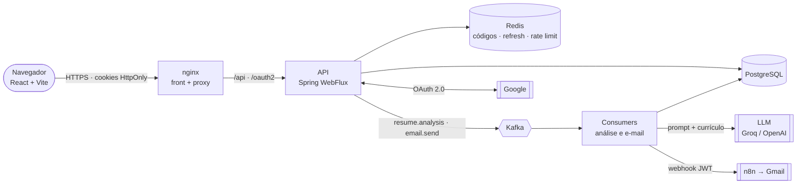
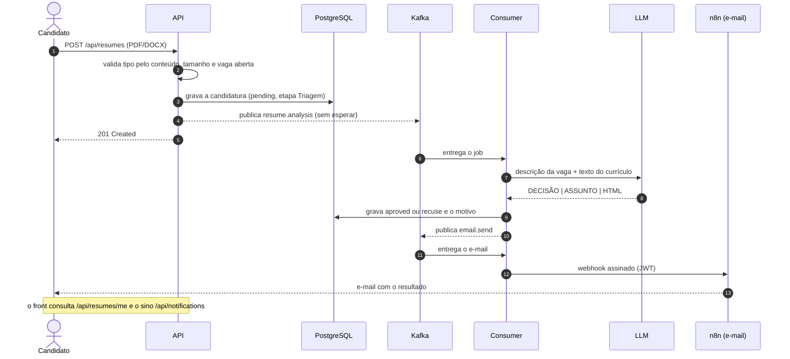
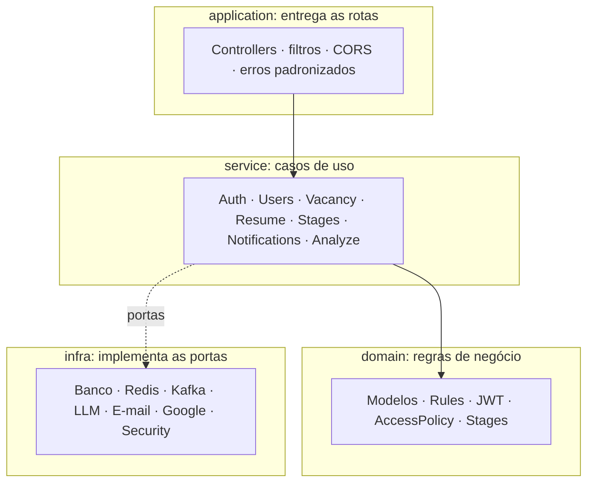
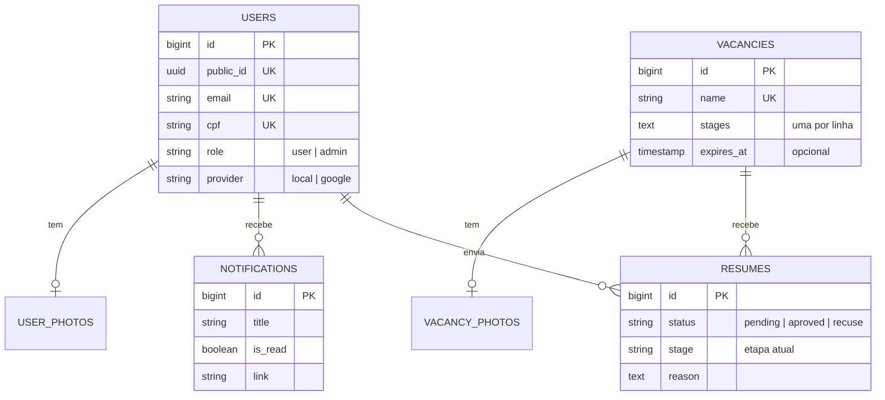

<div align="center">

# rhhub.

**Recrutamento com análise de currículos feita por IA.**
Publique vagas, receba candidaturas, acompanhe cada etapa do processo seletivo e deixe a triagem inicial por conta da inteligência artificial.

[](https://github.com/BrayanDevZN/RhHub/actions/workflows/ci.yml)


[Visão geral](#-visão-geral) ·
[Funcionalidades](#-funcionalidades) ·
[Arquitetura](#-arquitetura) ·
[Tecnologias](#-tecnologias) ·
[Como rodar](#-como-rodar) ·
[Testes](#-testes) ·
[Deploy](#-deploy) ·
[Documentação](#-documentação)

</div>

---

## 📌 Visão geral

O **RhHub** é uma plataforma de recrutamento com dois papéis:

- **Candidato:** cria a conta (e-mail e senha ou Google), escolhe uma vaga, envia o currículo em PDF ou DOCX e acompanha o resultado e a etapa em que está, com avisos por e-mail e dentro do app.
- **Administrador:** publica e edita vagas, define as etapas do processo, vê quantos candidatos cada vaga tem e move os aprovados de etapa.

Quando um currículo chega, ele **não é analisado na hora da requisição**: vai para uma fila (Kafka), um consumidor extrai o texto, pergunta à IA se o candidato combina com a vaga, grava o resultado e dispara o e-mail. Assim o envio responde rápido, e uma falha da IA ou do e-mail não perde a candidatura.

O RhHub é a evolução do [AgentRH](https://github.com/BrayanDevZN/AgentRH) (back end em Python/FastAPI), reescrito em Java com acesso a dados totalmente assíncrono e com um front end novo.

## ✨ Funcionalidades

| Área | O que faz |
|---|---|
| **Autenticação** | Cadastro com código por e-mail, login com e-mail e senha, **2FA opcional** por e-mail, recuperação de senha e login/cadastro com **Google**. Sessão por cookies `HttpOnly`, com renovação por refresh token |
| **Conta** | CPF, idade e gênero obrigatórios (o Google pede num passo extra após o cadastro), foto de perfil (JPEG, PNG ou WebP até 2 MB), exclusão da conta |
| **Vagas** | Nome único, descrição, requisitos e responsabilidades, foto de capa, **data de expiração opcional**, contador de candidatos (para admins) |
| **Etapas do processo** | Por padrão *Triagem → Entrevista → Contratado*. Só a **Triagem é obrigatória**; o admin remove, troca ou acrescenta etapas |
| **Candidaturas** | Upload validado pelo conteúdo do arquivo, uma candidatura por vaga, análise da IA em segundo plano, resultado `pending`, `aproved` ou `recuse` |
| **Notificações** | E-mail a cada resultado e mudança de etapa, e **sino dentro do app** com contador de não lidos, lista e atalho para o assunto |
| **Administração** | Gestão de usuários e papéis, visão de todas as candidaturas, admin raiz criado na subida |
| **Segurança** | BCrypt (custo 12), JWT HS256, CORS restrito, cabeçalhos de segurança, **rate limit por IP** no Redis |

## 🏗️ Arquitetura

### Visão de ponta a ponta



O navegador só conversa com o domínio do front. O nginx serve os arquivos estáticos e **repassa** `/api`, `/oauth2` e `/login/oauth2` para a API, o que mantém os cookies `SameSite` no mesmo site.

### O que acontece quando um candidato envia o currículo



Se o Kafka estiver fora na hora do envio, a candidatura continua `pending` e o `PendingResumeRepublisher` a reenfileira depois. Jobs que falham repetidamente vão para uma **dead letter queue** gravada no banco.

### Arquitetura em camadas do back end



| Camada | Responsabilidade |
|---|---|
| `domain` | Regras que não dependem de nada externo: modelos (`Vacancy`, `Resume`, `User`…), validações (`Rules`), etapas (`Stages`), JWT e política de acesso. Não conhece banco, rede nem Spring |
| `service` | Orquestra o domínio e as portas para cumprir cada caso de uso |
| `application` | Controllers REST sob `/api`, filtros (autenticação, rate limit, cabeçalhos), CORS e as **portas** (`port/in` e `port/out`) |
| `infra` | Adaptadores que implementam as portas: repositórios SQL, Redis, Kafka, provedor de IA, e-mail, Google OAuth e segurança |

O fluxo de uma requisição é `application` → `service` → `domain` + portas → `infra`. Isso permite testar os serviços com repositórios em memória e trocar uma implementação (por exemplo, o provedor de IA) sem mexer nas regras.

### Decisões de projeto

- **Reativo de ponta a ponta.** WebFlux e R2DBC: nenhum acesso a banco bloqueia a thread do servidor. O BCrypt (CPU pesada) roda em um scheduler separado.
- **Análise assíncrona.** Kafka desacopla o envio da análise e do e-mail; há reenfileiramento de pendentes e DLQ.
- **Banco duplo.** PostgreSQL em produção e SQLite para rodar sem infraestrutura; as tabelas são criadas na subida e **colunas novas são migradas automaticamente** em bancos já existentes.
- **Tokens fora do alcance do JavaScript.** Sessão em cookies `HttpOnly` + `Secure` + `SameSite`; o cookie do login com Google é `Lax`, porque o navegador descarta `Strict` numa volta vinda de outro site.
- **Sem vazamento de segredos.** Erros do Google e do servidor chegam à tela só como código curto, nunca com a mensagem interna.
- **Falha de aviso não derruba o fluxo.** Gravar uma notificação ou enfileirar um e-mail de etapa é "melhor esforço": o erro vai para o log e o processo segue.

### Modelo de dados



Apagar um usuário ou uma vaga apaga, em cascata, as candidaturas, fotos e avisos ligados a eles.

## 🧰 Tecnologias

| Camada | Tecnologias |
|---|---|
| **Back end** | Java 21, Spring Boot 3.5, Spring WebFlux, Project Reactor, R2DBC (PostgreSQL e pool), SQLite (JDBC), Spring Kafka, Spring Data Redis Reactive |
| **Documentos** | Apache PDFBox 3 (PDF) e Apache POI 5 (DOCX) para extrair o texto do currículo |
| **Front end** | React 19, TypeScript, Vite 8, Tailwind CSS 4, React Router 7, Base UI + componentes no estilo shadcn/ui, lucide-react, Three.js (`@react-three/fiber` e `drei`) na cena 3D do login |
| **Dados** | PostgreSQL 16, Redis 7 (códigos de verificação, refresh tokens e rate limit), Apache Kafka (tópicos `resume.analysis` e `email.send`) |
| **IA** | Qualquer provedor compatível com a API da OpenAI: Groq (`openai/gpt-oss-120b`) por padrão ou OpenAI (`gpt-4o-mini`). O prompt de triagem fica em `src/backend/resources/prompt/resume_analysis.md` |
| **E-mail** | Workflow no n8n (Gmail) chamado por webhook com JWT HS256; templates HTML em `src/backend/resources/templates` |
| **Autenticação** | BCrypt, JWT, Google OAuth 2.0, 2FA por e-mail |
| **Infra** | Docker e Docker Compose, nginx, Railway, GitHub Actions |
| **Testes** | JUnit 5 (tags `unit`, `integration`, `functional` e `live`), AssertJ, Mockito, Reactor Test, Spring Kafka Test |

## 📁 Estrutura do repositório

```text
RhHub/
├── src/
│   ├── backend/                    # API e consumers (Java / Spring Boot)
│   │   ├── src/br/rhhub/
│   │   │   ├── domain/             # modelos, regras, JWT, etapas
│   │   │   ├── service/            # casos de uso
│   │   │   ├── application/        # controllers, filtros, portas, DTOs
│   │   │   └── infra/              # banco, redis, kafka, llm, email, google, security
│   │   ├── resources/              # application.yml, prompt da IA, templates de e-mail
│   │   ├── test/                   # testes unitários, de web, de banco e de fluxo
│   │   └── kafka/                  # entrypoint do broker
│   └── frontend/                   # SPA React + nginx
│       └── src/
│           ├── pages/              # Login, Cadastro, Vagas, Candidaturas, Perfil, Admin…
│           ├── components/         # layout, sino, etapas, tabela de candidaturas, ui/
│           └── lib/                # api.ts (cliente HTTP), auth, tipos, formatação
├── Dockerfile · Dockerfile.Api · Dockerfile.Consumer · Dockerfile.kafka · Dockerfile.front
├── docker-compose.yml              # Postgres, Redis, Kafka, API, consumer e front
├── railway.*.json                  # configuração de cada serviço no Railway
├── .github/                        # CI (um job por categoria de teste), templates de PR e issue, dependabot, CODEOWNERS
├── DOCUMENTACAO.md                 # documentação completa (rotas, regras, variáveis)
└── PROJECT_ANATOMY.md              # mapa de arquivos do projeto
```

## 🚀 Como rodar

### Com Docker Compose (recomendado)

Pré-requisitos: Docker e Docker Compose.

```bash
cp .env.compose.example .env
# edite o .env: senhas, ADMIN_EMAIL, ADMIN_PASSWORD e as chaves de IA e e-mail
docker compose up --build
```

O front fica em <http://localhost:9000> e repassa `/api` para a API. Para http local, mantenha `COOKIE_SECURE=false` e `FRONTEND_URL=http://localhost:9000` (já vêm no exemplo).

### Em desenvolvimento

Back end (Java 21 e Maven):

```bash
cd src/backend
./mvnw spring-boot:run
```

Front end (Node 22):

```bash
cd src/frontend
npm ci
npm run dev
```

### Variáveis de ambiente principais

| Variável | Para que serve |
|---|---|
| `ADMIN_EMAIL` · `ADMIN_PASSWORD` | Admin raiz, criado na subida (o e-mail precisa ser `@gmail.com`) |
| `JWT_SECRET` | Segredo dos tokens. Vazio gera um aleatório a cada subida |
| `DATABASE_URL` · `REDIS_HOST` · `REDIS_PORT` · `REDIS_PASSWORD` · `KAFKA_URL` | Conexões. Sem `DATABASE_URL`, a API usa SQLite (`SQLITE_PATH`) |
| `groq_key` ou `open_ai_key` | Chave do provedor de IA |
| `N8N_EMAIL_WEBHOOK_URL` · `gmail_secret` | Webhook do envio de e-mail e o segredo que assina a chamada |
| `GOOGLE_OAUTH_ENABLED` · `GOOGLE_CLIENT_ID` · `GOOGLE_CLIENT_SECRET` · `GOOGLE_REDIRECT_URI` | Login com Google (desligado por padrão) |
| `FRONTEND_URL` | Origem liberada no CORS e destino do retorno do Google |
| `BACKEND_URL` | Lida pelo **front** (nginx): para onde repassar `/api` |
| `COOKIE_SECURE` · `COOKIE_SAMESITE` | Atributos dos cookies de sessão |

A lista completa, com exemplos, está em [`src/backend/.env.example`](src/backend/.env.example) e na [`DOCUMENTACAO.md`](DOCUMENTACAO.md).

## 🧪 Testes

Os testes do back end ficam em `src/backend/test` e são divididos em **três categorias**, marcadas com tags do JUnit 5 (anotações em `br.rhhub.testing`). Todos rodam no **ambiente de teste** (`ENVIRONMENT=test`): os códigos de verificação voltam na resposta, a IA é substituída por uma resposta fixa e os cookies não exigem HTTPS, então nada depende de e-mail nem de chave externa.

| Categoria | Anotação | O que testa | Precisa de | Testes |
|---|---|---|---|---|
| **Unit** | `@UnitTest` | Regras de domínio, serviços (com repositórios em memória), validações, composição de e-mail, configuração | Nada: roda só na memória | 121 |
| **Integration** | `@IntegrationTest` | Uma peça de infraestrutura de cada vez: repositórios em SQLite e PostgreSQL, criação e migração de tabelas, Redis, Kafka embarcado, clientes HTTP (Google, n8n, LLM) contra um servidor local | SQLite e Kafka embarcado já vêm; PostgreSQL e Redis são usados se estiverem de pé (senão o teste é pulado) | 80 |
| **Functional** | `@FunctionalTest` | O sistema por fora: a API HTTP inteira (login, vagas, etapas, candidaturas, notificações, administração, retorno do Google) e o fluxo completo candidatura → fila → análise → e-mail | Nada externo | 33 |
| **Live** | `@LiveTest` | Chama **Groq e n8n/Gmail de verdade** (gasta cota e envia e-mail). **Fora de todas as execuções, inclusive do CI** | As chaves no ambiente | 3 |

```bash
cd src/backend

mvn test                          # unit + integration + functional (não roda os live)
mvn test -Pcategory-unit          # só unit
mvn test -Pcategory-integration   # só integration
mvn test -Pcategory-functional    # só functional
mvn test -Pcategory-live          # só live (opt-in: usa as chaves reais do ambiente)
```

Ao escrever um teste novo, anote a classe com a categoria certa (`@UnitTest`, `@IntegrationTest` ou `@FunctionalTest`); sem anotação o teste roda só na execução completa e fica fora das categorias do CI.

No front, o CI roda lint e build:

```bash
cd src/frontend
npm run lint && npm run build
```

O workflow [`ci.yml`](.github/workflows/ci.yml) tem **um job por categoria** (`unit`, `integration` com PostgreSQL e Redis de verdade, `functional`), mais o front, a conferência de que `Dockerfile` e `Dockerfile.front` são idênticos e o build das imagens Docker. Roda a cada push na `main` e em todo pull request.

## ☁️ Deploy

O projeto roda no **Railway** com um serviço por Dockerfile:

| Serviço | Dockerfile | Observação |
|---|---|---|
| Front (nginx) | `Dockerfile` | Lê `BACKEND_URL` e repassa `/api`, `/oauth2` e `/login/oauth2` |
| API | `Dockerfile.Api` | `railway.api.json` |
| Consumers (análise e e-mail) | `Dockerfile.Consumer` | `railway.consumer.json` |
| Kafka | `Dockerfile.kafka` | Precisa de um **volume** em `/var/lib/kafka/data`, senão cada reinício apaga os tópicos |

Front e API precisam responder **no mesmo domínio** (via proxy do nginx), porque os cookies de sessão são `SameSite=Strict`. Detalhes de Kafka, rede privada e Watch Paths estão em [`src/backend/README.md`](src/backend/README.md).

## 📚 Documentação

| Documento | Conteúdo |
|---|---|
| [`DOCUMENTACAO.md`](DOCUMENTACAO.md) | Arquitetura detalhada, modelo de dados, fluxos de autenticação, **todas as rotas**, regras de validação e variáveis de ambiente |
| [`src/backend/README.md`](src/backend/README.md) | Camadas do back end, estado de cada uma e notas de deploy |
| [`src/backend/HISTORICO.md`](src/backend/HISTORICO.md) | Decisões, problemas encontrados e o que falta |
| [`PROJECT_ANATOMY.md`](PROJECT_ANATOMY.md) | Mapa de todos os arquivos, com tamanho estimado |

## 👥 Autoria

Desenvolvido por [Brayan](https://github.com/BrayanDevZN) e [DuduSouza10](https://github.com/DuduSouza10).
