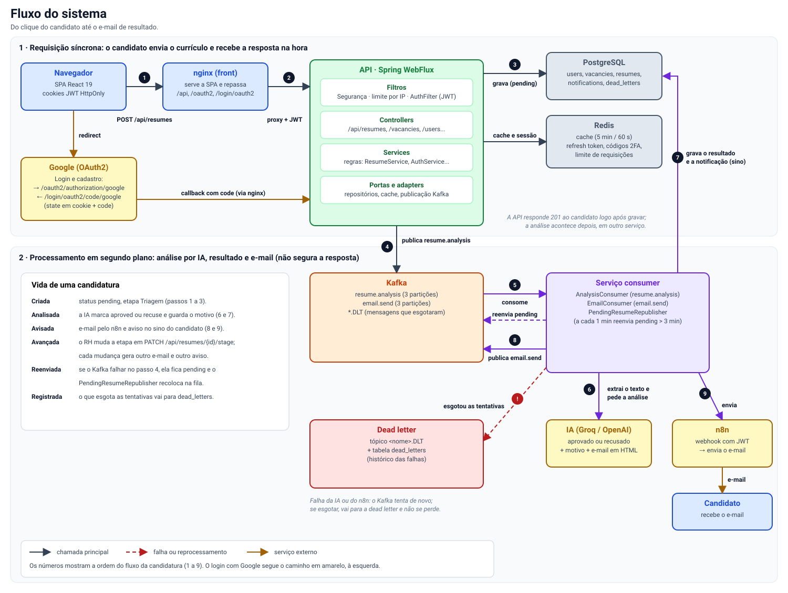
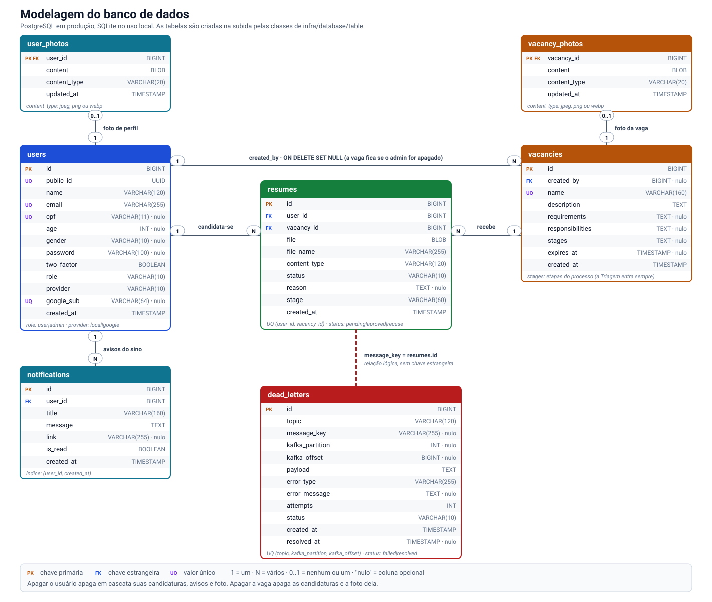

# Arquitetura do RhHub

Plataforma de recrutamento: o RH publica vagas, o candidato se inscreve enviando o currículo e uma IA faz a triagem inicial. O candidato acompanha cada etapa do processo e recebe e-mail e aviso a cada mudança.

Este documento explica **como o sistema é organizado e por quê**. Os dois diagramas completam a leitura:

- [`fluxo-do-sistema.svg`](fluxo-do-sistema.svg): o caminho de uma candidatura, do navegador ao e-mail.
- [`modelagem-banco.svg`](modelagem-banco.svg): as tabelas, as chaves e as relações.



## 1. Visão geral: quatro serviços

O sistema roda como **quatro serviços independentes** (cada um com seu Dockerfile e seu serviço no Railway):

| Serviço | Papel | Tecnologia |
|---|---|---|
| **Front** | Entrega a tela (SPA) e repassa `/api`, `/oauth2` e `/login/oauth2` para a API | React 19 + TypeScript + Vite, servido por nginx |
| **API** | Recebe as requisições HTTP, aplica as regras e responde | Java 21, Spring Boot 3.5, WebFlux (reativo) |
| **Consumer** | Trabalha em segundo plano: lê as filas, chama a IA e manda e-mail | O mesmo jar da API, com o consumo do Kafka ligado |
| **Kafka** | Fila de mensagens entre a API e o Consumer | Apache Kafka |

Mais três peças de apoio: **PostgreSQL** (dados), **Redis** (cache, sessão, limites) e serviços externos (**Google**, **Groq/OpenAI**, **n8n**).

**Por que o front repassa a API?** O navegador só fala com o domínio do front. Assim os cookies de sessão (`HttpOnly`, `SameSite=Strict`) funcionam sem configuração de CORS complicada.

**Por que existe o Consumer?** Analisar um currículo com IA leva segundos. A API não espera: grava a candidatura, coloca uma mensagem na fila e responde 201. O Consumer faz o trabalho pesado depois. Se a IA ou o e-mail falharem, a mensagem não se perde (ver seção 5).

## 2. O backend: arquitetura hexagonal

O código do backend fica em `src/backend/src` (os pacotes Java são `br.rhhub.*`). A ideia central é que o **miolo do sistema não conhece tecnologia**: ele só conhece interfaces, chamadas de *portas*. Banco, Kafka, Redis, Google e IA são *adapters* plugados por fora.

```
 HTTP ──► application/web ──► service ──► application/port/out  (interfaces)
          (controllers,       (regras)           ▲
           filtros)                              │ implementadas por
                                                 │
                                        infra/* (PostgreSQL, Redis, Kafka, Google, IA, n8n)

 domain/  (modelos, validações, JWT, erros) é usado por todos e não depende de ninguém.
```

| Pasta | Responsabilidade |
|---|---|
| `domain/` | Modelos (`User`, `Vacancy`, `Resume`...), validações (`Rules`), etapas (`Stages`), JWT e política de acesso, erros de negócio |
| `service/` | Regras de negócio, um serviço por assunto: `AuthService`, `ResumeService`, `ResumeStageService`, `VacancyService`... |
| `application/web/` | Controllers REST, filtros (segurança, limite, autenticação) e a conversão para JSON (`Views`) |
| `application/port/out/` | Interfaces do que o sistema precisa de fora: `UserRepository`, `AiProvider`, `EmailSender`, `RateLimiter`... |
| `infra/` | Implementações: `database`, `cache`, `redis`, `messaging` (Kafka), `llm`, `email`, `google`, `security`, `config` |

**Vantagem prática:** dá para trocar PostgreSQL por SQLite (uso local), ou a IA por uma resposta fixa (`ENVIRONMENT=test`), sem mexer em nenhuma regra. Os testes usam versões em memória das portas (`tests/support/service/Fakes.java`).

**Reativo (WebFlux):** todo método devolve `Mono` (zero ou um valor) ou `Flux` (vários). Nenhuma thread fica parada esperando banco ou rede, então poucos recursos atendem muitas requisições. Trabalho que bloqueia de verdade (hash BCrypt, envio ao Kafka) roda em threads separadas (`boundedElastic`).

## 3. Segurança e sessão

- **Login:** e-mail e senha (hash BCrypt, calculado fora da thread do servidor) ou Google. Só contas `@gmail.com`.
- **JWT em cookie `HttpOnly`:** token de acesso de 15 min e refresh token de 7 dias. O refresh fica registrado no Redis, então é possível encerrar sessões.
- **2FA opcional** por e-mail para contas locais. Código de 6 dígitos que vale uma vez, 1 pedido por minuto e no máximo 5 tentativas.
- **Cadastro** exige confirmar o e-mail com código.
- **Filtros em toda requisição:** cabeçalhos de segurança, limite de requisições por IP (contador no Redis) e `AuthFilter`, que valida o JWT em tudo que é `/api`, menos as rotas públicas.
- **Login com Google:** o `state` viaja em cookie, o backend troca o `code` pelo perfil e entra na conta, ou cria uma nova só no modo "cadastrar". Conta nova precisa completar CPF, idade e gênero.
- **Papéis:** `user` (candidato) e `admin` (RH). Um admin raiz é criado na subida a partir das variáveis de ambiente.

## 4. Dados

PostgreSQL em produção e SQLite no uso local. As tabelas são criadas na subida por classes Java (`infra/database/table`), sem ferramenta de migração. Veja o desenho completo em [`modelagem-banco.svg`](modelagem-banco.svg).



Decisões de modelagem que valem a pena saber:

- **Fotos em tabelas separadas** (`user_photos`, `vacancy_photos`): a imagem é pesada, e assim as consultas de usuário e de vaga não a carregam.
- **Um currículo por pessoa e vaga:** a chave única `(user_id, vacancy_id)` impede candidatura duplicada.
- **Cascata:** apagar o usuário apaga candidaturas, avisos e foto. Apagar a vaga apaga as candidaturas e a foto. Se o admin que criou a vaga for apagado, a vaga fica (`created_by` vira nulo).
- **`dead_letters` não tem chave estrangeira:** guarda o histórico de mensagens do Kafka que falharam; `message_key` é o id da candidatura, uma relação só lógica.
- **Etapas da vaga:** ficam num campo de texto da própria vaga. A "Triagem" sempre existe; a candidatura nasce nela.

## 5. Mensageria e resiliência

Dois tópicos no Kafka, cada um com 3 partições:

| Tópico | Quem publica | Quem consome | O que faz |
|---|---|---|---|
| `resume.analysis` | API (ao receber o currículo) | `AnalysisConsumer` | Extrai o texto, pergunta à IA e grava aprovado ou recusado |
| `email.send` | Análise e mudança de etapa | `EmailConsumer` | Envia o e-mail pelo webhook do n8n |

O que acontece quando algo dá errado:

1. **Kafka fora do ar ao enviar o currículo:** a candidatura já foi gravada e fica `pending`. A cada minuto, o `PendingResumeRepublisher` recoloca na fila as que estão pendentes há mais de 3 minutos (no máximo uma vez a cada 10). Reenviar é seguro, porque a análise ignora candidatura que já saiu de `pending`.
2. **IA ou n8n falham:** o Kafka tenta de novo. Esgotadas as tentativas, o `DeadLetterRecoverer` grava a falha na tabela `dead_letters` **e** publica a mensagem original no tópico `<nome>.DLT`. Se qualquer um dos dois falhar, a mensagem é entregue de novo, então o job nunca se perde (gravar duas vezes não duplica: a origem é única).
3. **Redis fora do ar:** o cache é só um atalho. Qualquer falha vira "não achei" e a leitura segue pelo banco; o cache fica desligado por 30 s para não pagar o tempo limite a cada requisição.

## 6. Cache (Redis)

Cache-aside: lê do cache, se não achar lê do banco e guarda com validade. Quem altera ou apaga um dado apaga a entrada.

- **Identidade de quem está logado** (papel, id, nome): lida em toda requisição autenticada, guardada por 5 minutos. Nunca guarda hash de senha nem o id do Google.
- **Vagas:** 5 minutos. **Avisos do sino:** 60 segundos. Ambos são apagados ao alterar ou apagar.
- Além do cache, o Redis guarda o refresh token, os códigos de verificação e o contador do limite de requisições.

## 7. Integrações externas

| Serviço | Para quê | Onde no código |
|---|---|---|
| **Google OAuth2** | Login e cadastro | `infra/google`, `application/web/GoogleController` |
| **Groq / OpenAI** (API compatível) | Analisar o currículo contra a vaga | `infra/llm`; o prompt está em `resources/prompt/resume_analysis.md` |
| **n8n** | Enviar o e-mail (webhook assinado com JWT) | `infra/email` |

Com `ENVIRONMENT=test` a IA devolve uma resposta fixa, o e-mail só é registrado no log e os códigos de verificação voltam na resposta, o que permite testar tudo sem rede.

## 8. Testes

Ficam em `tests/` na raiz do repositório, separados por categoria (tags do JUnit):

| Pasta | O que cobre | Precisa de infraestrutura? |
|---|---|---|
| `tests/unit` | Regras, serviços, validações, cache | Não |
| `tests/integration` | Banco (SQLite e PostgreSQL), Redis, Kafka embutido, cliente do Google e da IA, e-mail | Alguns (Redis, PostgreSQL) |
| `tests/functional` | As rotas de ponta a ponta com filtros e cookies, o login com Google e o fluxo completo da análise | Kafka embutido |
| `tests/support` | Apoio compartilhado: `Fakes`, `TestSupport`, anotações | |

O CI roda um job por categoria.

## 9. Deploy

Railway, um serviço por Dockerfile: `Dockerfile.front`, `Dockerfile.Api`, `Dockerfile.Consumer` e `Dockerfile.kafka`, cada um com seu `railway.*.json`. Localmente, `docker compose up --build` sobe tudo (PostgreSQL, Redis, Kafka, API, consumer e front). Variáveis de ambiente e passo a passo: [`README.md`](../README.md) e [`DOCUMENTACAO.md`](../DOCUMENTACAO.md).
